# MTA Subway Hourly Ridership

**Nama Kelompok:** Kelompok Smile  
**Anggota:**  
- Muhammad Abil Khoiri (101032330094)  
- Firdaus Arif Ramadhani (101032300131)  

**Topik Proyek:** Analisis dan Prediksi Volume Kepadatan Penumpang Kereta Bawah Tanah (*MTA Subway Hourly Ridership*) Menggunakan Integrasi Data *Real-Time* GTFS  

**Tautan Proyek:**  
- Repositori GitHub: https://github.com/fxrdhan/mta-subway-bigdata  
- Sumber Data *Batch*: https://data.ny.gov/d/5wq4-mkjj  
- Sumber Data *Streaming*: https://api.mta.info/ (*MTA Real-Time GTFS Feed*)  

---

## I. Latar Belakang

Jaringan kereta bawah tanah (*subway*) Metropolitan Transportation Authority (MTA) New York City melayani jutaan komuter setiap hari melalui 428 kompleks stasiun. Tingginya volume mobilitas harian memicu risiko penumpukan penumpang (*overcrowding*) di peron dan ketidakefisienan alokasi frekuensi armada kereta. Selain itu, masa transisi sistem tiket dari kartu magnetik (MetroCard) ke pembayaran nirsentuh digital (OMNY) menuntut penataan gerbang masuk (*turnstile*) yang adaptif.

Melalui integrasi data historis volume penumpang per jam (*batch data*) dan pemantauan pergerakan armada secara langsung melalui General Transit Feed Specification Realtime (GTFS-RT *streaming*), sistem dapat memprediksi lonjakan komuter, mengorelasikan keterlambatan kereta dengan kepadatan stasiun, serta mengoptimalkan operasi transit secara tepat.

---

## II. 5W1H

### *What*:
Analisis pola pergerakan, peramalan (*forecasting*) kepadatan penumpang per jam (*hourly ridership*), dan pemantauan keterlambatan armada kereta secara *real-time* pada 428 kompleks stasiun *subway* MTA New York City menggunakan *pipeline big data* dan *machine learning*.

### *Why*:
1. Memitigasi risiko penumpukan komuter yang berbahaya (*crowd safety*) di peron stasiun pada jam sibuk (*rush hour*).
2. Menyesuaikan frekuensi perjalanan kereta secara dinamis berdasarkan kebutuhan riil penumpang untuk efisiensi operasional dan energi.
3. Memetakan kecepatan adopsi tiket nirsentuh (OMNY) dibandingkan dengan kartu fisik (MetroCard) guna optimalisasi fasilitas gerbang stasiun.

### *Who*:
1. Metropolitan Transportation Authority (MTA) dan New York City Transit (NYCT) sebagai operator utama sekaligus pengambil kebijakan armada.
2. New York City Department of Transportation (NYC DOT) untuk integrasi antarmoda transportasi perkotaan.
3. Manajer operasional dan petugas keamanan stasiun untuk pengendalian kerumunan di lapangan.
4. Komuter dan masyarakat pengguna transportasi massal Kota New York.

### *Where*:
1. Data *Batch*: portal resmi Open Data Pemerintah Negara Bagian New York ([data.ny.gov](https://data.ny.gov/d/5wq4-mkjj)), diakses via SODA API ([data.ny.gov/resource/5wq4-mkjj.json](https://data.ny.gov/resource/5wq4-mkjj.json)).
2. Data *Streaming*: portal pengembang resmi MTA ([api.mta.info](https://api.mta.info/)) yang berbasis spesifikasi protokol [GTFS Realtime](https://gtfs.org/realtime/).

### *When*:
1. Periode Data Historis (*Batch*): 1 Januari 2025 hingga 8 Oktober 2026 (terdiri atas 46.363.790 baris data terverifikasi tanpa *null*).
2. Pembaruan Data (*Streaming*): data posisi armada (*Vehicle Positions*) dan estimasi kedatangan (*Trip Updates*) yang mengalir setiap 30 detik secara kontinu.

### *How*:
1. *Pipeline & Ingestion*:
   - *Batch Processing*: ekstraksi data via DuckDB dan Apache Arrow dengan format penyimpanan terkompresi Apache Parquet (zstd), yang mereduksi 46,4 juta baris menjadi 128 MB; pada rancangan *pipeline* (bagian VII), data *ridership* diolah dengan pola ELT di MinIO (*bronze*, *silver*, dan *gold*) memakai DuckDB.
   - *Streaming Ingestion*: penarikan *feed* GTFS-RT setiap 30 detik menggunakan *producer* Python menuju *topic* Kafka (`mta-gtfs-stream`, retensi 24 jam) untuk diolah secara *real-time* oleh Spark Structured Streaming dengan pola ETL.
2. *Storage Management*:
   - SQL (PostgreSQL): menyimpan data tabular agregat per stasiun dan *borough* serta keterlambatan kereta per menit (disimpan 14 hari) dan per jam; dibaca oleh aplikasi Streamlit (*dashboard* dan prediksi) serta Grafana (pemantauan *resource* dan *pipeline*).
   - NoSQL (MongoDB): menyimpan kedatangan kereta dan *alert* layanan dari GTFS-RT dengan TTL 7 hari; *snapshot* mentah GTFS-RT disimpan di MinIO selama 2 hari.
3. *Machine Learning*:
   - Regresi: prediksi volume penumpang jam berikutnya ($\log(1 + \text{ridership})$) per stasiun.
   - Klasifikasi: identifikasi kondisi jam sibuk (*peak* versus *off-peak*) serta deteksi anomali keterlambatan jalur kereta.
   - *Clustering* (K-Means): segmentasi 428 kompleks stasiun berdasarkan profil fluktuasi komuter (kawasan perkantoran, permukiman, atau transit wisata).

## Diagram Alir *Data Wrangling*

Diagram alir berikut merangkum tiga tahap *data wrangling* pada *notebook*: (a) *gathering* (bagian III), (b) *assessing*, dan (c) *cleaning* (bagian IV).

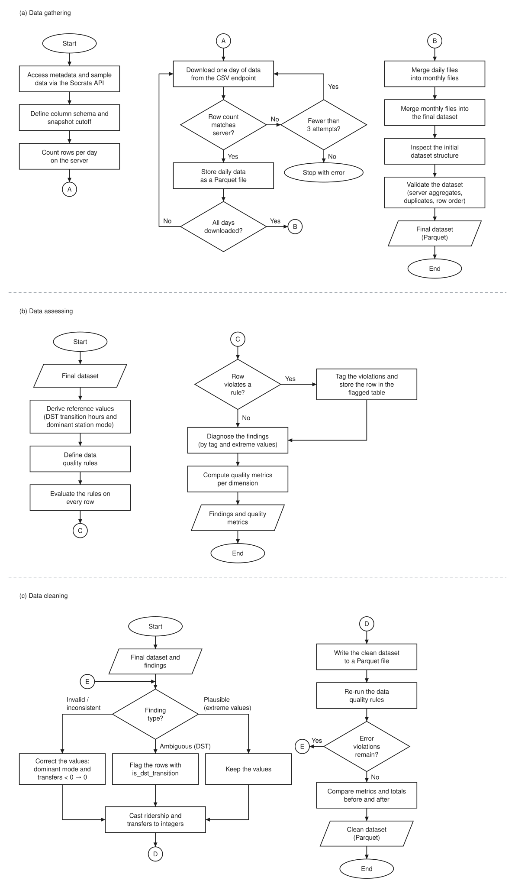

Sumber diagram dapat dibuka dan diedit di [Excalidraw](https://excalidraw.com/#json=vkhoVKhEYBX2iMafjqULz,B0VVTglBLE_UX4sAZNldlw) atau dari berkas [`docs/diagrams/data_wrangling_flowchart.excalidraw`](docs/diagrams/data_wrangling_flowchart.excalidraw).

## III. *Data Wrangling* – *Gathering Data*

Bagian ini mendokumentasikan tahap pengumpulan data (*gathering*) untuk *dataset* MTA Subway Hourly Ridership. Seluruh prosesnya dijalankan di Google Colab dan dijelaskan langkah demi langkah pada *notebook* proyek (bagian **III**).

- *Notebook* Google Colab: https://colab.research.google.com/drive/1GU64Yx-8Bq7PgxiG-lg5t9dnfb1lKIH5
- *Notebook* lengkap dengan keluaran eksekusi: [`notebooks/MTA_Subway_Hourly_Ridership.ipynb`](notebooks/MTA_Subway_Hourly_Ridership.ipynb) 
- Salinan kode *notebook* di repositori: [`notebooks/minggu3_gathering_data.ipynb`](notebooks/minggu3_gathering_data.ipynb) 
- *Notebook* versi data terbaru (*cutoff* 2026-10-08 23:00, 46.363.790 baris): [`notebooks/MTA_Subway_Hourly_Ridership_2025-01_2026-10.ipynb`](notebooks/MTA_Subway_Hourly_Ridership_2025-01_2026-10.ipynb) . Isinya sama dengan *notebook* lengkap, ditambah opsi `USE_DRIVE_CACHE` yang menyimpan berkas harian di Google Drive agar sesi Colab berikutnya tidak perlu mengunduh ulang data seluruh hari, serta pengecekan revisi per hari (jumlah baris, total, dan `:updated_at` server) sehingga hanya data hari yang berubah yang diunduh ulang. Angka bagian III dan IV pada README ini dan pada laporan kedua bagian tersebut tetap mengikuti *cutoff* 2026-09-16 23:00.
- *Notebook* EDA (data *cutoff* 2026-10-08): [`notebooks/MTA_Subway_Hourly_Ridership_EDA_2025-01_2026-10.ipynb`](notebooks/MTA_Subway_Hourly_Ridership_EDA_2025-01_2026-10.ipynb) . *Notebook* ini membaca *dataset* bersih dari Google Drive tanpa mengunduh ulang dari API, lalu menganalisis pola jam dan hari, tren bulanan, OMNY dan MetroCard, stasiun, profil jam per stasiun, dan distribusi target regresi.
- *Notebook* pemodelan (data *cutoff* 2026-10-08): [`notebooks/MTA_Subway_Hourly_Ridership_Modeling_2025-01_2026-10.ipynb`](notebooks/MTA_Subway_Hourly_Ridership_Modeling_2025-01_2026-10.ipynb) . Isinya regresi penumpang per stasiun per jam (dua skenario ketersediaan data), klasifikasi jam padat, dan K-Means profil stasiun; semuanya memakai *dataset* bersih yang sama dengan *notebook* EDA.
- Laporan tugas Minggu 3: [`docs/TugasMinggu3_BIG-DATA_TK47G06_101032330094-101032300131.pdf`](docs/TugasMinggu3_BIG-DATA_TK47G06_101032330094-101032300131.pdf) ([DOCX](docs/TugasMinggu3_BIG-DATA_TK47G06_101032330094-101032300131.docx))
- *Dataset* final: [`mta_subway_hourly_ridership_2025-01_2026-09.parquet`](https://drive.google.com/file/d/1NqbE12P5M6n3l-Q3FYXfoErJgZijpI3k/view?usp=sharing) (124,2 MB, Google Drive). Berkas ini tidak di-*commit* ke repositori karena ukurannya melebihi batas ukuran berkas GitHub (100 MB).

### 1. Sumber dan Cara Memperoleh Data

| Item | Keterangan |
|---|---|
| Nama *dataset* | MTA Subway Hourly Ridership: Beginning 2025 |
| ID *dataset* | `5wq4-mkjj` |
| Pemilik | Metropolitan Transportation Authority (MTA) |
| Portal | [data.ny.gov/d/5wq4-mkjj](https://data.ny.gov/d/5wq4-mkjj) (NY Open Data) |
| *Endpoint* data | `https://data.ny.gov/resource/5wq4-mkjj` (format `.json` dan `.csv`, SODA API) |
| *Endpoint* metadata | `https://data.ny.gov/api/views/5wq4-mkjj.json` |
| Frekuensi pembaruan | Mingguan (menurut metadata portal) |
| Lisensi | Kolom lisensi pada metadata portal kosong sehingga lisensi tidak dinyatakan secara eksplisit |

Data diperoleh langsung dari sumber utama lewat **SODA API** menggunakan permintaan HTTP GET (pustaka `requests`) tanpa autentikasi. Pengambilan lewat API lebih dipilih daripada unduhan manual karena data terus diperbarui dan API mendukung penyaringan (`$where`), pengurutan (`$order`), pembagian halaman (`$limit`, `$offset`), dan agregasi di sisi server (`$select`, `$group`). Fitur-fitur ini diperlukan untuk memfiksasi *snapshot* dan memvalidasi hasilnya.

Sumber lain yang dipertimbangkan adalah sebagai berikut.

- **MTA Subway Hourly Ridership: 2020-2024** (`wujg-7c2s`, 120.855.567 baris) memiliki skema identik dan menyambung tanpa celah dengan *dataset* utama (31 Desember 2024 pukul 23.00, lalu 1 Januari 2025 pukul 00.00). *Dataset* ini hanya diperiksa metadatanya dan tidak dimasukkan karena ruang lingkup proyek difiksasi pada data 2025 dan seterusnya.
- ***Feed* GTFS-RT MTA** (sumber *streaming*) tidak termasuk dalam *dataset* yang difiksasi pada tahap ini dan akan dikumpulkan pada tahap *streaming*.

### 2. Karakteristik Awal *Dataset*

| Karakteristik | Nilai |
|---|---|
| Granularitas | 1 baris = jam × kompleks stasiun × metode pembayaran × kelas tarif |
| Periode (*snapshot*) | 1 Januari 2025 pukul 00.00 s.d. 16 September 2026 pukul 23.00 (624 hari), kondisi server setelah pembaruan 30 September 2026 |
| Jumlah baris | 45.244.036 |
| Jumlah kolom | 12 |
| Kompleks stasiun | 428 |
| Moda transportasi | 3: *subway* (99,27% baris), Staten Island Railway (0,39%), dan *tram* (0,35%) |
| *Borough* | 5: Brooklyn (35,34%), Manhattan (30,90%), Queens (17,37%), Bronx (16,00%), dan Staten Island (0,39%) |
| Metode pembayaran | OMNY (55,41% baris; 87,7% total penumpang) dan MetroCard (44,59% baris) |
| Kelas tarif | 12 kategori |
| `ridership` | Minimum 1; median 7; rata-rata 49,49; persentil ke-95 188; maksimum 23.510; total 2.238.989.512 |
| `transfers` | Minimum −30; median 0; rata-rata 2,47; maksimum 2.556; total 111.767.871 |
| Nilai kosong (*null*) | 0 pada seluruh kolom |
| Ukuran | 374,3 MB (624 berkas harian) dan 124,2 MB (1 berkas final), format Parquet zstd |

| No. | Kolom | Tipe (Arrow) | Keterangan |
|:-:|---|---|---|
| 1 | `transit_timestamp` | `timestamp[us]` | Waktu lokal New York, dibulatkan ke bawah ke jam terdekat, tanpa zona waktu |
| 2 | `transit_mode` | `string` | `subway`, `staten_island_railway`, atau `tram` |
| 3 | `station_complex_id` | `string` | Pengenal kompleks stasiun |
| 4 | `station_complex` | `string` | Nama kompleks stasiun beserta rute |
| 5 | `borough` | `string` | Wilayah administratif |
| 6 | `payment_method` | `string` | `omny` atau `metrocard` |
| 7 | `fare_class_category` | `string` | Kelas tarif |
| 8 | `ridership` | `float64` | Jumlah penumpang masuk |
| 9 | `transfers` | `float64` | Bagian dari `ridership` yang masuk lewat transfer gratis |
| 10 | `latitude` | `float64` | Lintang stasiun |
| 11 | `longitude` | `float64` | Bujur stasiun |
| 12 | `georeference` | `string` | Titik lokasi berformat WKT `POINT (bujur lintang)` |

Catatan awal untuk tahap *assessing* dan *cleaning* (belum diperbaiki pada tahap ini): 226 baris `transfers` bernilai negatif, satu jam tidak muncul pada rentang waktu (2026-03-08 02:00, peralihan DST), satu kompleks stasiun (St George, ID 501) tercatat dengan dua moda, dan `transit_timestamp` tidak memuat zona waktu. Seluruh catatan ini ditangani pada bagian IV.

### 3. Tahapan *Gathering*

| No. | Tahap | Metode | Bagian *notebook* | Hasil |
|:-:|---|---|:-:|---|
| 1 | Verifikasi sumber dan metadata | `GET /api/views/5wq4-mkjj.json` | 4.1 | Nama, pemilik, frekuensi pembaruan, dan tipe kolom |
| 2 | Melihat bentuk mentah respons | `GET .json` dan `.csv` dengan `$limit=3` | 4.2 | Angka dikirim sebagai teks dan `georeference` berupa objek GeoJSON pada JSON |
| 3 | Menetapkan skema target | Skema `pyarrow` eksplisit | 4.3 | 12 kolom bertipe tetap |
| 4 | Fiksasi *snapshot* | `count(*)`, total nilai, dan `max(transit_timestamp)` di server | 5.1 | *Cutoff* 2026-09-16 23:00; 45.244.036 baris |
| 5 | Rencana pengambilan | `GROUP BY` tanggal di server | 5.2 | Jumlah baris untuk 624 hari |
| 6 | Pengambilan per hari | CSV per halaman, enam unduhan paralel, *retry* dengan *backoff* | 6 | 624 berkas Parquet harian |
| 7 | Penggabungan | *Concat* harian → bulanan → final (DuckDB) | 7 | 21 berkas bulanan dan 1 berkas final |
| 8 | Pemeriksaan struktur awal | SQL DuckDB dan `pandas` | 8 | Dimensi, tipe, *null*, sebaran, dan statistik |
| 9 | Validasi | Perbandingan agregat harian dengan server (`pd.merge`), duplikat, dan urutan | 9 | 624 hari sama dengan server; 0 duplikat kunci; 0 baris tidak urut |

Rincian penting pada tahap pengambilan adalah sebagai berikut.

- ***Endpoint* CSV dengan skema tetap.** CSV dibaca oleh `pyarrow` dengan tipe kolom yang ditentukan pada awal sehingga seluruh potongan seragam.
- **Satu hari per pekerjaan.** Filter waktu membatasi setiap permintaan pada satu hari dan tidak melewati *cutoff*. Bila hasilnya lebih dari 500.000 baris, data diambil per halaman dengan urutan `:id` yang deterministik.
- **Validasi per hari.** Jumlah baris hasil unduhan harus sama dengan jumlah dari server. Bila berbeda, pengambilan diulang hingga tiga kali.
- **Aman dilanjutkan.** Hari yang berkasnya sudah ada dengan jumlah baris yang benar dilewati sehingga sesi Colab yang terputus dapat dilanjutkan tanpa mengunduh ulang.
- **Revisi mingguan sumber.** *Cutoff* membatasi rentang waktu, tetapi tidak membekukan isi data: pada setiap pembaruan mingguan, MTA juga menambah dan merevisi baris beberapa bulan terakhir. Pembaruan 30 September 2026 menambah 309 baris dan memperbarui 6.419.272 baris sebelum *cutoff* (bukti `:updated_at` pada bagian 5.1 *notebook*). Oleh karena itu, nilai acuan mengikuti kondisi server setelah pembaruan tersebut, dan salinan yang tetap adalah *dataset* final di Google Drive.

### 4. *Dataset* dan Berkas yang Digunakan

| Lapisan | Lokasi (pada Colab) | Isi | Ukuran |
|---|---|---|---|
| Sumber | `data.ny.gov/resource/5wq4-mkjj` | Data asli di server | – |
| Harian | `/content/mta_subway/01_daily/YYYY-MM/YYYY-MM-DD.parquet` | 624 berkas | 374,3 MB |
| Bulanan | `/content/mta_subway/02_monthly/year=YYYY/month=MM/part-0.parquet` | 21 berkas, terurut menurut kunci | ≈ 124,8 MB |
| **Final** | `/content/mta_subway/03_final/mta_subway_hourly_ridership_2025-01_2026-09.parquet` | 1 berkas, 45.244.036 baris × 12 kolom | 124,2 MB |
| Bersih (bagian IV) | `/content/mta_subway/04_clean/mta_subway_hourly_ridership_clean_2025-01_2026-09.parquet` | 1 berkas, 45.244.036 baris × 13 kolom | 124,3 MB |

Berkas pada repositori adalah sebagai berikut.

| Berkas | Keterangan |
|---|---|
| [`notebooks/MTA_Subway_Hourly_Ridership.ipynb`](notebooks/MTA_Subway_Hourly_Ridership.ipynb) | *Notebook* lengkap proyek beserta seluruh keluaran eksekusi di Google Colab |
| [`notebooks/minggu3_gathering_data.ipynb`](notebooks/minggu3_gathering_data.ipynb) | Salinan kode bagian III versi Minggu 3 (*gathering data*) |
| [`notebooks/MTA_Subway_Hourly_Ridership_2025-01_2026-10.ipynb`](notebooks/MTA_Subway_Hourly_Ridership_2025-01_2026-10.ipynb) | Bagian III dan IV dengan data *cutoff* 2026-10-08 (46.363.790 baris), *cache* berkas harian di Google Drive, dan pengecekan revisi per hari |
| [`notebooks/MTA_Subway_Hourly_Ridership_EDA_2025-01_2026-10.ipynb`](notebooks/MTA_Subway_Hourly_Ridership_EDA_2025-01_2026-10.ipynb) | *Exploratory data analysis* (bagian V) |
| [`notebooks/MTA_Subway_Hourly_Ridership_Modeling_2025-01_2026-10.ipynb`](notebooks/MTA_Subway_Hourly_Ridership_Modeling_2025-01_2026-10.ipynb) | Pemodelan: regresi, klasifikasi, dan K-Means (bagian VI) |
| [`docs/TugasMinggu3_BIG-DATA_TK47G06_101032330094-101032300131.pdf`](docs/TugasMinggu3_BIG-DATA_TK47G06_101032330094-101032300131.pdf) | Berkas laporan resmi tugas Minggu 3 (tersedia pula dalam format [DOCX](docs/TugasMinggu3_BIG-DATA_TK47G06_101032330094-101032300131.docx)) |
| [`docs/TugasMinggu9_BIG-DATA_TK47G06_101032330094-101032300131.pdf`](docs/TugasMinggu9_BIG-DATA_TK47G06_101032330094-101032300131.pdf) | Laporan tugas Minggu 9: rancangan *pipeline* ETL dan ELT (bagian VII; tersedia pula dalam format [DOCX](docs/TugasMinggu9_BIG-DATA_TK47G06_101032330094-101032300131.docx)) |
| [`docs/diagrams/`](docs/diagrams/) | Diagram alir *data wrangling* (sumber Excalidraw dan SVG) serta diagram alir *gathering* bagian III per bagian (ringkasan dan empat diagram rinci, sumber PlantUML dan PNG): [`gathering_2025-01_2026-09/`](docs/diagrams/gathering_2025-01_2026-09/) untuk *notebook* utama dan [`gathering_2025-01_2026-10/`](docs/diagrams/gathering_2025-01_2026-10/) untuk *notebook cutoff* 2026-10-08 |
| [`src/download_snapshot.py`](src/download_snapshot.py), [`src/soda.py`](src/soda.py) | Skrip pengambilan yang sama untuk dijalankan di komputer lokal |
| `data/final/` | Lokasi salinan lokal *dataset* final (tidak di-*commit* karena besar) |

*Notebook* yang sama juga dijalankan di komputer lokal pada 6 Oktober 2026. Hasilnya sama dengan hasil di Colab dalam hal jumlah baris (45.244.036), total `ridership` (2.238.989.512), total `transfers` (111.767.871), dan seluruh hasil pemeriksaan bagian III dan IV. Pengambilan lokal sebelumnya (`src/download_snapshot.py`, 29 September 2026) menghasilkan 45.243.727 baris karena dilakukan sebelum pembaruan data MTA 30 September 2026.

### 5. Proses Penggabungan Data

Data berasal dari satu *dataset* sumber, tetapi diterima dalam 624 potongan harian. Penggabungannya berupa **penggabungan vertikal** (*concat*, setara dengan `UNION ALL`) karena seluruh potongan memiliki kolom dan tipe yang sama. *Join* tidak diperlukan karena tidak ada tabel lain yang perlu disambungkan. Operasi `pd.merge` dipakai pada tahap validasi untuk membandingkan agregat harian lokal dengan agregat server.

1. **Halaman → hari.** Bila hasil satu hari lebih dari satu halaman (500.000 baris), halaman-halaman digabung dengan `pa.concat_tables`. Pada data ini, hari terbanyak hanya berisi 93.017 baris sehingga setiap hari cukup satu halaman.
2. **Contoh `pd.concat`.** Tiga hari pertama digabung dengan `pd.concat` untuk memperlihatkan operasinya (74.914 + 77.324 + 78.251 = 230.489 baris; lihat bagian 7.1 *notebook*).
3. **Harian → bulanan.** Seluruh berkas harian pada satu bulan dibaca dengan pola `*.parquet`, diurutkan menurut kunci (`transit_timestamp`, `station_complex_id`, `payment_method`, `fare_class_category`), dan ditulis sebagai satu berkas Parquet. Jumlah baris tiap bulan divalidasi terhadap server.
4. **Bulanan → final.** Ke-21 berkas bulanan disambung berurutan menjadi satu berkas. Pengurutan ulang tidak diperlukan karena tiap berkas sudah terurut dan rentang waktu antarbulan tidak tumpang tindih.

DuckDB dipakai untuk data penuh karena membaca Parquet secara kolumnar dan dapat memakai *disk* bila memori tidak cukup, sedangkan `pd.concat` pada 45 juta baris akan membebani RAM Colab.

Hasil penggabungan harian → bulanan adalah sebagai berikut. Jumlah baris setiap bulan sama dengan jumlah di server.

| Bulan | Hari | Baris | Ukuran (MB) |
|:-:|:-:|--:|--:|
| 2025-01 | 31 | 2.398.982 | 6,2 |
| 2025-02 | 28 | 2.273.357 | 5,7 |
| 2025-03 | 31 | 2.599.249 | 6,7 |
| 2025-04 | 30 | 2.646.409 | 6,5 |
| 2025-05 | 31 | 2.776.119 | 6,8 |
| 2025-06 | 30 | 2.673.221 | 6,7 |
| 2025-07 | 31 | 2.711.975 | 6,8 |
| 2025-08 | 31 | 2.681.448 | 6,8 |
| 2025-09 | 30 | 2.581.490 | 6,6 |
| 2025-10 | 31 | 2.578.816 | 6,7 |
| 2025-11 | 30 | 2.341.100 | 6,3 |
| 2025-12 | 31 | 2.209.615 | 6,3 |
| 2026-01 | 31 | 1.859.429 | 5,9 |
| 2026-02 | 28 | 1.658.281 | 5,2 |
| 2026-03 | 31 | 1.840.773 | 5,8 |
| 2026-04 | 30 | 1.725.407 | 5,4 |
| 2026-05 | 31 | 1.757.955 | 5,5 |
| 2026-06 | 30 | 1.683.124 | 5,3 |
| 2026-07 | 31 | 1.731.874 | 5,5 |
| 2026-08 | 31 | 1.706.174 | 5,4 |
| 2026-09 | 16 | 809.238 | 2,7 |
| **Total** | **624** | **45.244.036** | **≈ 124,8** |

### 6. Kendala dan Cara Mengatasinya

| No. | Kendala | Cara mengatasi |
|:-:|---|---|
| 1 | Ukuran data besar (45,2 juta baris) sehingga tidak praktis diambil dalam satu permintaan dan berisiko membebani memori Colab | Data dibagi per hari (624 potongan), disimpan sebagai Parquet terkompresi, dan digabung dengan DuckDB yang memproses data secara kolumnar dan dapat memakai *disk* |
| 2 | Respons JSON mengirim seluruh angka sebagai teks dan `georeference` sebagai objek GeoJSON | Memakai *endpoint* CSV dengan skema `pyarrow` eksplisit sehingga tipe kolom seragam di seluruh potongan |
| 3 | Layanan publik dapat memutus atau menolak permintaan (*timeout*, kode 429/5xx). Pada uji lokal, terjadi satu `ReadTimeout` | Fungsi `soda_get` melakukan *retry* dengan jeda eksponensial (hingga delapan kali). Permintaan yang mengalami `ReadTimeout` tersebut diulang secara otomatis dan berhasil. Pada *run* final di Colab, tidak diperlukan *retry* |
| 4 | *Dataset* diperbarui mingguan dan setiap pembaruan juga merevisi baris beberapa bulan terakhir sehingga dua pengambilan pada waktu berbeda dapat menghasilkan *dataset* berbeda walau *cutoff*-nya sama | Rentang data dibatasi dengan *cutoff* `transit_timestamp <= 2026-09-16 23:00`; nilai acuan (jumlah baris, total `ridership`, total `transfers`) dicocokkan dengan server; riwayat revisi ditampilkan lewat `:updated_at`; dan salinan yang tetap disimpan di Google Drive |
| 5 | Kueri agregat pada server lambat (satu `count(*)` pernah memakan waktu sekitar 30 detik) | Kueri agregat dibatasi pada empat kueri; seluruh validasi harian memakai satu kueri `GROUP BY` |
| 6 | Sesi Colab bersifat sementara sehingga berkas dan progres hilang saat sesi berakhir | Pengambilan bersifat *idempotent* (hari yang sudah ada dilewati; terbukti pada eksekusi ulang yang melewati seluruh 624 hari). Tersedia opsi untuk menyalin *dataset* final ke Google Drive |
| 7 | Kualitas data awal: 226 baris `transfers` negatif, satu jam hilang, dan satu stasiun dengan dua moda | Tidak diubah pada tahap *gathering*. Dicatat dan ditangani pada tahap *assessing* dan *cleaning* (bagian IV) |

### 7. Hasil Akhir Proses *Gathering*

Hasil pemeriksaan pada *run* final *notebook* (VM Colab baru, 6 Oktober 2026) adalah sebagai berikut.

| Pemeriksaan | Bagian *notebook* | Hasil |
|---|:-:|---|
| Baris, total `ridership`, dan total `transfers` sampai *cutoff* sama dengan nilai acuan | 5.1 | Sama |
| Baris harian = baris server | 6.2 | 45.244.036 = 45.244.036 |
| Baris tiap bulan = baris server dan rentang antarbulan tidak tumpang tindih | 7.2 | 21 dari 21 bulan sesuai |
| Tidak ada nilai *null* dan *string* kosong | 8.3 | 0 pada seluruh kolom |
| Agregat per hari (baris, `ridership`, `transfers`) sama dengan server | 9.1 | 624 hari dibandingkan, 0 berbeda |
| Tidak ada duplikat kunci dan data terurut menurut kunci (berkas bulanan) | 9.2 | 0 duplikat, 0 baris tidak urut |
| Waktu tidak mundur pada berkas final | 9.2 | 0 |

| Atribut | Nilai |
|---|---|
| Berkas | `mta_subway_hourly_ridership_2025-01_2026-09.parquet` |
| Format | Apache Parquet (kompresi zstd) |
| Ukuran | 124,2 MB |
| Baris × kolom | 45.244.036 × 12 |
| Rentang waktu | 2025-01-01 00:00 s.d. 2026-09-16 23:00 |
| Kompleks stasiun | 428 |
| Total `ridership` | 2.238.989.512 |
| Waktu pengambilan 624 hari | 11,3 menit pada *run* final (enam unduhan paralel); pengambilan penuh di Colab memakan waktu 8,6 sampai 19,8 menit, bergantung pada beban server |

*Dataset* final ini menjadi masukan tahap *assessing* dan *cleaning* (bagian IV).

### 8. Bukti Pelaksanaan di Google Colab

Gambar berikut sama dengan gambar pada laporan tugas Minggu 3 ([PDF](docs/TugasMinggu3_BIG-DATA_TK47G06_101032330094-101032300131.pdf)). Gambar diambil dari eksekusi *notebook* di Google Colab sebelum pembaruan data MTA 30 September 2026 sehingga angkanya mengikuti *snapshot* saat itu (45.243.727 baris). Angka terkini ada pada bagian-bagian di atas dan pada *notebook*.

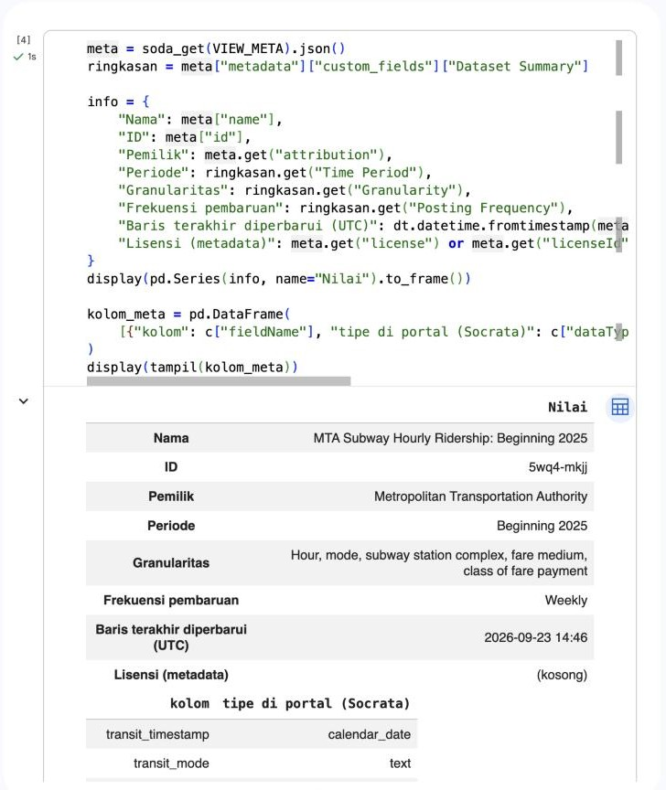
*Gambar 1 Metadata Dataset dari Endpoint `/api/views`*

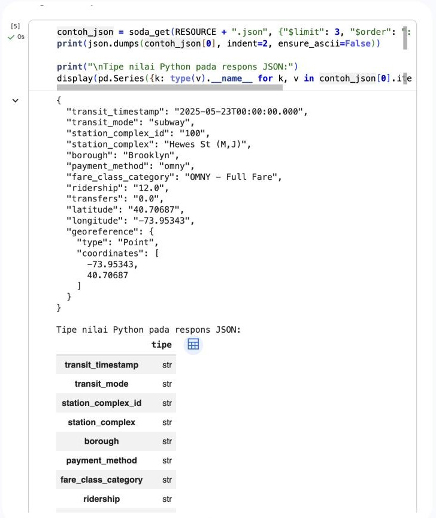
*Gambar 2 Bentuk Mentah Respons JSON*

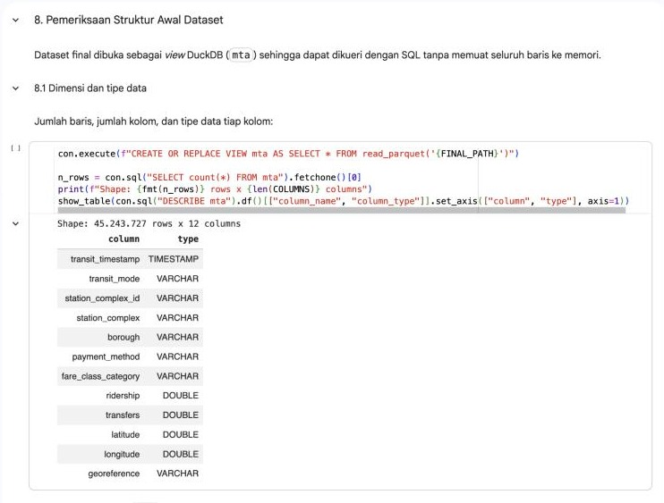
*Gambar 3 Dimensi dan Tipe Data Dataset Final*

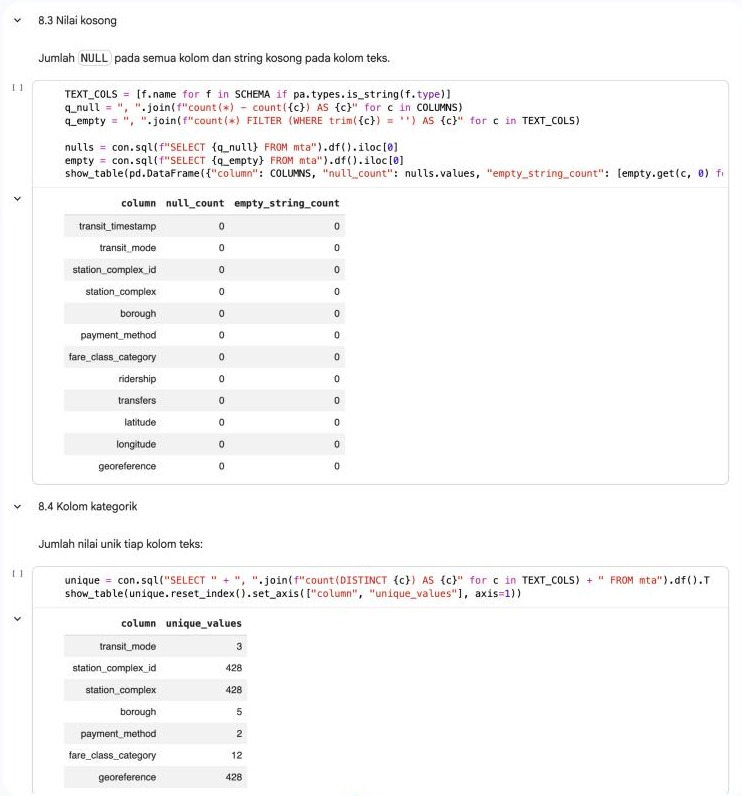
*Gambar 4 Jumlah Nilai Kosong (0 pada Seluruh Kolom) dan Jumlah Nilai Unik Kolom Teks*

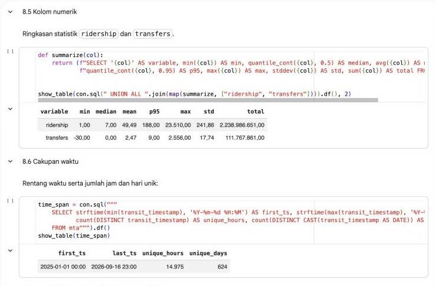
*Gambar 5 Statistik Kolom Numerik dan Cakupan Waktu*

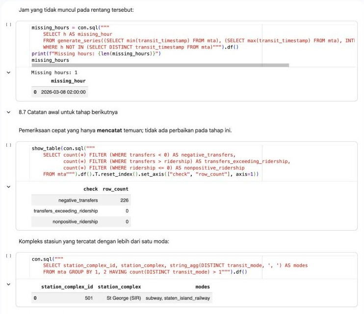
*Gambar 6 Temuan Awal, yaitu Jam yang Tidak Muncul, `transfers` Negatif, dan Stasiun dengan Dua Moda*

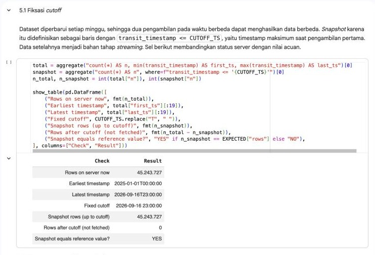
*Gambar 7 Jumlah Baris sampai Cutoff Sama dengan Nilai Acuan*

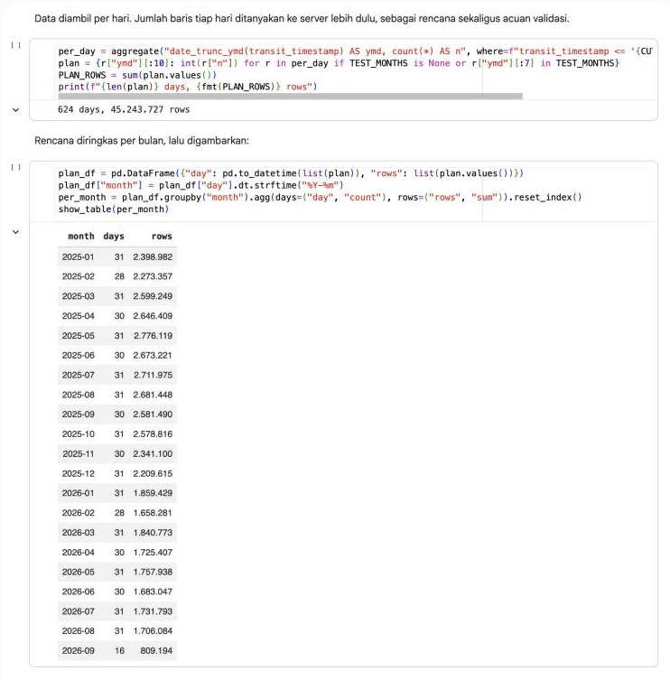
*Gambar 8 Rencana Pengambilan: Jumlah Hari dan Baris per Bulan*

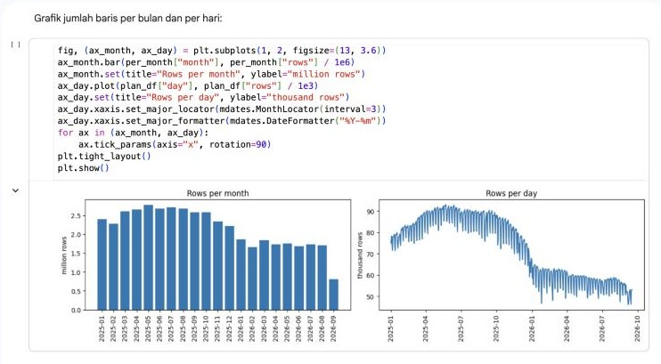
*Gambar 9 Grafik Jumlah Baris per Bulan dan per Hari*

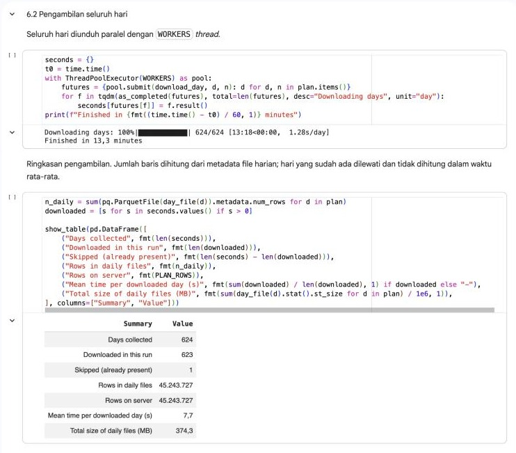
*Gambar 10 Pengambilan 624 Hari secara Paralel beserta Ringkasannya*

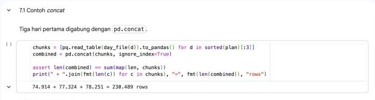
*Gambar 11 Contoh Penggabungan Tiga Hari Pertama dengan `pd.concat`*

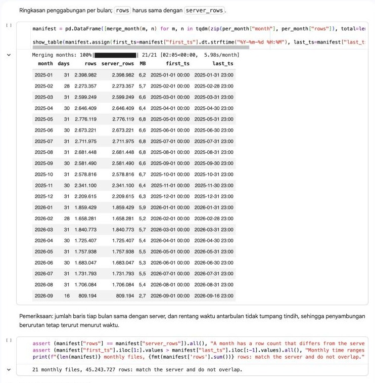
*Gambar 12 Penggabungan Harian ke Bulanan*

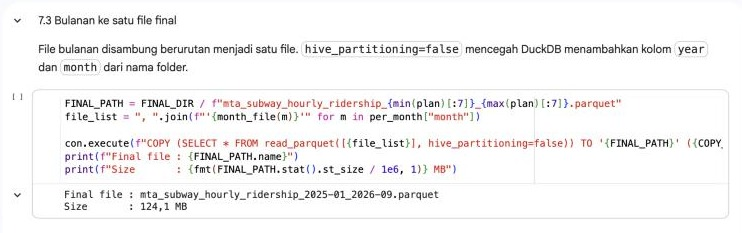
*Gambar 13 Penggabungan Bulanan ke Satu Berkas Final*

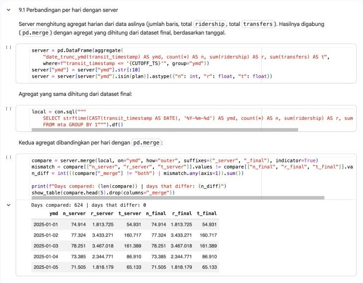
*Gambar 14 Perbandingan Agregat Harian dengan Server*

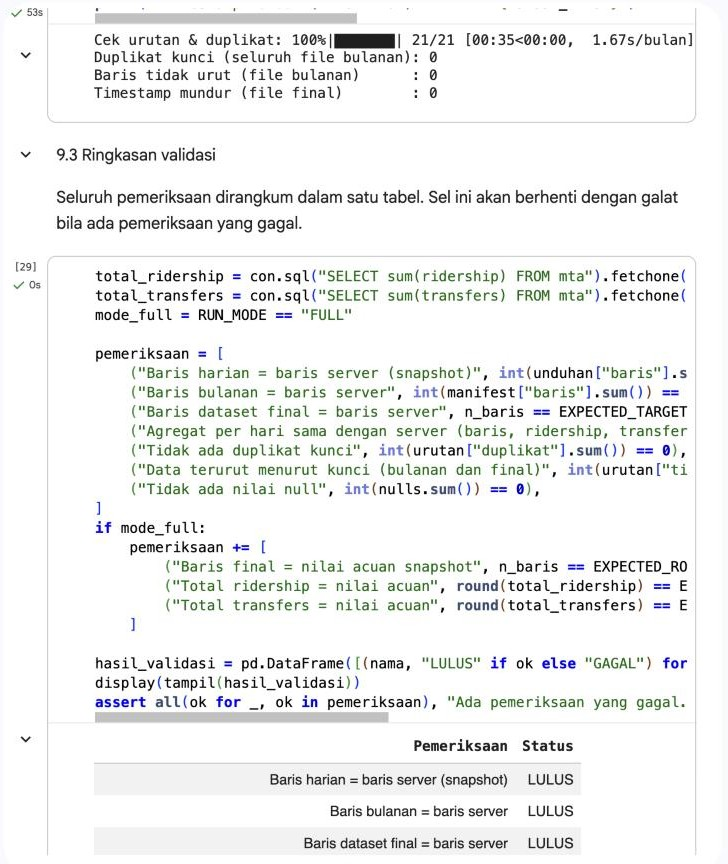
*Gambar 15 Pemeriksaan Duplikat Kunci dan Urutan Data*

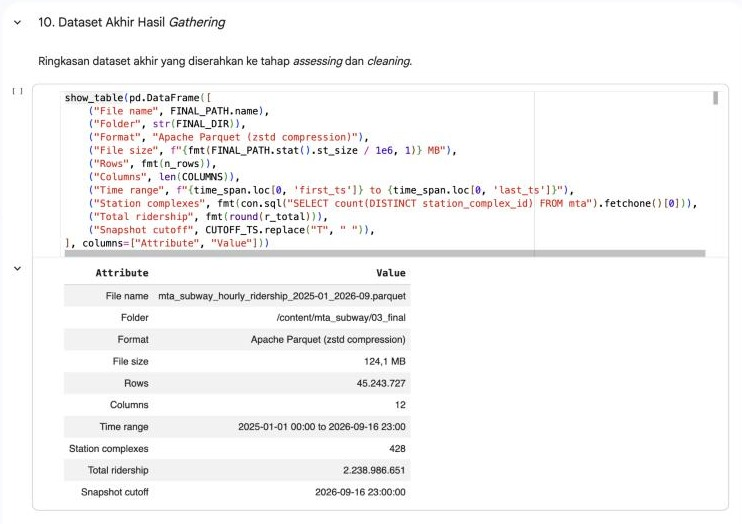
*Gambar 16 Ringkasan Dataset Akhir Hasil Gathering*

## IV. *Data Wrangling* – *Assessing* dan *Cleaning Data*

Pada bagian ini, kualitas *dataset* hasil *gathering* dinilai dengan aturan yang terukur, setiap baris yang melanggar ditandai (*error tagging*) dan dibersihkan, lalu hasilnya dibuktikan dengan metrik kualitas sebelum dan sesudah *cleaning*. Seluruh proses dijalankan dengan DuckDB pada *notebook* proyek (bagian **IV**), tanpa memuat 45 juta baris ke memori.

### 1. Aturan Kualitas Data

Setiap aturan ditulis sebagai kondisi SQL yang bernilai benar bila sebuah baris melanggarnya. Tingkat `error` berarti nilainya salah dan harus diperbaiki; `warning` berarti nilainya bukan salah catat, tetapi perlu ditandai.

| Tag | Dimensi | Tingkat | Aturan |
|---|---|:-:|---|
| `missing_value` | *Completeness* | `error` | Ada kolom yang `NULL` |
| `invalid_category` | *Validity* | `error` | `transit_mode`, `payment_method`, atau `borough` di luar nilai yang terdokumentasi |
| `nonpositive_ridership` | *Validity* | `error` | `ridership` nol atau negatif |
| `negative_transfers` | *Validity* | `error` | `transfers` negatif |
| `transfers_exceed_ridership` | *Validity* | `error` | `transfers` lebih besar daripada `ridership` |
| `non_integer_count` | *Validity* | `error` | `ridership` atau `transfers` bukan bilangan bulat |
| `outside_nyc` | *Validity* | `error` | Koordinat di luar wilayah New York City |
| `not_on_hour` | *Validity* | `error` | `transit_timestamp` tidak tepat pada pergantian jam |
| `fare_class_payment_mismatch` | *Consistency* | `error` | Awalan `fare_class_category` berbeda dengan `payment_method` |
| `station_mode_mismatch` | *Consistency* | `error` | `transit_mode` berbeda dengan moda dominan stasiunnya |
| `georeference_mismatch` | *Consistency* | `error` | `georeference` berbeda dengan `latitude` dan `longitude` |
| `dst_transition_hour` | *Accuracy* | `warning` | Jam lokal yang tidak ada atau terjadi dua kali karena peralihan DST |

Keunikan baris memakai hasil pemeriksaan duplikat kunci pada bagian III (0 duplikat).

### 2. Hasil Penandaan dan Temuan

Dari 45.244.036 baris, 3.672 baris bertanda. Aturan yang tidak tercantum di bawah ini memiliki 0 pelanggaran.

| Tag | Tingkat | Baris |
|---|:-:|--:|
| `negative_transfers` | `error` | 226 |
| `station_mode_mismatch` | `error` | 2 |
| `dst_transition_hour` | `warning` | 3.444 |

- **`transfers` negatif.** Seluruhnya merupakan baris OMNY di empat kompleks stasiun dan bertanggal 17 Mei sampai 16 September 2026, yaitu rentang yang masih direvisi MTA setiap minggu.

  | Kompleks stasiun | Baris | Minimum | Jumlah nilai negatif |
  |---|--:|--:|--:|
  | Beach 67 St (A) | 91 | −2 | −96 |
  | 14 St/6 Av (1,2,3,L,F,M) | 64 | −30 | −119 |
  | Metropolitan Av/Lorimer St (G,L) | 42 | −2 | −43 |
  | Woodhaven Blvd (J,Z) | 29 | −2 | −30 |

- **Moda St George (ID 501).** Sebanyak 116.098 baris tercatat `staten_island_railway`, tetapi 2 baris (18 Juni dan 8 September 2026, masing-masing 1 penumpang) tercatat `subway`.
- **Jam peralihan DST.** Kolom `transit_timestamp` berisi waktu lokal tanpa zona waktu sehingga label jamnya ambigu saat peralihan DST.

  | Jam lokal | Jenis | Baris | `ridership` | Rata-rata jam yang sama ±7 hari |
  |---|---|--:|--:|--:|
  | 2025-03-09 02:00 | Tidak ada | 1.255 | 4.340 | 12.636 |
  | 2025-11-02 01:00 | Terulang | 2.189 | 47.605 | 27.060 |
  | 2026-03-08 02:00 | Tidak ada | 0 | 0 | 14.775 |

  Jam yang terulang berisi hampir dua kali jumlah penumpang normal karena dua jam tercatat dalam satu label. Jam yang tidak ada justru berisi data pada 2025, tetapi kosong pada 2026 sehingga pencatatan DST tidak konsisten antartahun.
- **Nilai ekstrem `ridership`.** Lima kombinasi jam dan stasiun tertinggi seluruhnya terjadi di Grand Central-42 St pukul 17.00 pada hari kerja (tertinggi 25.147 penumpang) sehingga wajar dan bukan kesalahan.

### 3. Tindakan *Cleaning*

Tidak ada baris yang dihapus karena seluruh temuan dapat diperbaiki atau cukup ditandai.

| Temuan | Tindakan | Alasan |
|---|---|---|
| `station_mode_mismatch` | `transit_mode` diganti dengan moda dominan stasiunnya | Satu kompleks stasiun dilayani satu moda; nilai yang menyimpang adalah salah catat |
| `negative_transfers` | `transfers` negatif diubah menjadi 0 | `transfers` adalah jumlah orang sehingga tidak mungkin negatif; `ridership` pada baris yang sama tidak berubah |
| `ridership` dan `transfers` bertipe desimal | Diubah menjadi bilangan bulat (`INTEGER`) | Keduanya merupakan hitungan orang dan seluruh nilainya bulat |
| `dst_transition_hour` | Ditandai dengan kolom baru `is_dst_transition`; nilai tidak diubah | Penumpangnya nyata, tetapi label jamnya ambigu sehingga tidak dapat dipisah atau dipindah |
| Nilai ekstrem `ridership` | Dipertahankan | Terjadi pada jam sibuk sore di Grand Central-42 St |

Kueri *cleaning* hanya berupa proyeksi tanpa *join* sehingga urutan baris berkas final tetap terjaga dan berkas bersih tidak perlu diurutkan ulang.

### 4. Validasi dan Metrik Kualitas

Seluruh aturan dijalankan ulang pada berkas bersih: tag `error` menjadi 0, dan 3.444 baris `warning` seluruhnya bertanda `is_dst_transition`. Skor setiap dimensi adalah persentase baris yang lolos seluruh aturan `error` pada dimensi tersebut.

| Dimensi | Gagal (sebelum) | Skor sebelum | Gagal (sesudah) | Skor sesudah |
|---|--:|--:|--:|--:|
| *Completeness* | 0 | 100,000000% | 0 | 100,000000% |
| *Consistency* | 2 | 99,999996% | 0 | 100,000000% |
| *Validity* | 226 | 99,999500% | 0 | 100,000000% |
| *Uniqueness* | 0 | 100,000000% | 0 | 100,000000% |
| Seluruh aturan baris | 228 | 99,999496% | 0 | 100,000000% |

| Ukuran | Sebelum | Sesudah | Selisih |
|---|--:|--:|--:|
| Baris | 45.244.036 | 45.244.036 | 0 |
| Total `ridership` | 2.238.989.512 | 2.238.989.512 | 0 |
| Total `transfers` | 111.767.871 | 111.768.159 | +288 |
| Baris dengan `transfers` negatif | 226 | 0 | −226 |

Waktu pada berkas bersih tidak pernah mundur (0 baris), sama dengan berkas final.

### 5. *Dataset* Bersih

| Atribut | Nilai |
|---|---|
| Berkas | `mta_subway_hourly_ridership_clean_2025-01_2026-09.parquet` |
| Lokasi | `/content/mta_subway/04_clean/` di Colab, dengan salinan di Google Drive |
| Format | Apache Parquet (kompresi zstd) |
| Ukuran | 124,3 MB |
| Baris × kolom | 45.244.036 × 13 (12 kolom asli dan `is_dst_transition`) |
| Tipe yang berubah | `ridership` dan `transfers` menjadi `INTEGER`; `is_dst_transition` bertipe `BOOLEAN` |
| Baris bertanda `is_dst_transition` | 3.444 |
| Pelanggaran aturan `error` | 0 |

## V. *Exploratory Data Analysis* (EDA)

Bagian V dan VI memakai *dataset* bersih versi *cutoff* 2026-10-08 (46.363.790 baris, 1 Januari 2025 s.d. 8 Oktober 2026) dari *notebook* [`MTA_Subway_Hourly_Ridership_2025-01_2026-10.ipynb`](notebooks/MTA_Subway_Hourly_Ridership_2025-01_2026-10.ipynb) sehingga angkanya berbeda dengan angka bagian III dan IV (*cutoff* 2026-09-16). Rincian, grafik, dan seluruh angka ada pada *notebook* [`MTA_Subway_Hourly_Ridership_EDA_2025-01_2026-10.ipynb`](notebooks/MTA_Subway_Hourly_Ridership_EDA_2025-01_2026-10.ipynb).

| Aspek | Temuan |
|---|---|
| Volume | Rata-rata 3,60 juta penumpang per hari: 4,05 juta pada hari kerja dan 2,46 juta pada akhir pekan |
| Pola jam | Hari kerja memiliki puncak pukul 08.00 (9,2% penumpang harian) dan 17.00 (10,0%); empat jam tersibuk menampung 34,8% penumpang. Akhir pekan hanya memiliki satu puncak landai sekitar pukul 16.00 |
| Hari anomali | Enam dari delapan hari kerja tersepi adalah hari libur nasional Amerika Serikat. Penurunan paling tajam terjadi pada 25—26 Januari dan 22—23 Februari 2026, yang penyebabnya tidak tercatat di *dataset* |
| Tren | Setiap bulan Januari—September 2026 lebih ramai daripada bulan yang sama pada 2025 (+0,1% s.d. +7,1%); rata-rata harian terendah pada Januari dan Agustus |
| Metode pembayaran | Porsi OMNY naik dari 66,6% (Januari 2025) menjadi 99,7% (Oktober 2026); transisi praktis selesai pada awal 2026 |
| Stasiun | Manhattan menampung 55,9% penumpang dan 50 kompleks teratas 45,3%. Times Sq-42 St mencatat rata-rata 133.123 penumpang per hari |
| Profil stasiun | Sebanyak 297 kompleks lebih ramai pada pagi hari (pola permukiman) dan 131 pada sore hari (pola perkantoran) |
| Target regresi | Distribusi penumpang per stasiun per jam sangat condong ke kanan (*skewness* 7,66) dan mendekati simetris setelah $\log(1 + \text{ridership})$ (−0,27); 1,98% kombinasi stasiun-jam tidak tercatat dan diperlakukan sebagai nol |

## VI. Pemodelan (*Machine Learning*)

*Notebook* [`MTA_Subway_Hourly_Ridership_Modeling_2025-01_2026-10.ipynb`](notebooks/MTA_Subway_Hourly_Ridership_Modeling_2025-01_2026-10.ipynb) membangun grid 428 kompleks stasiun × 15.501 jam. Model dilatih pada data sampai 30 Juni 2026 dan diuji pada data 1 Juli s.d. 8 Oktober 2026 (100 hari).

Regresi dibuat dalam dua skenario karena data *ridership* baru dirilis MTA sekitar 6,5 sampai 12 hari setelah jam kejadian: skenario A memakai data penumpang mulai 1 jam sebelumnya (seolah-olah data *real-time* tersedia), sedangkan skenario B memakai data berumur minimal 14 hari (sesuai rilis MTA).

| Model | Hasil pada periode uji |
|---|---|
| Regresi, skenario A | WAPE 9,64%, dibandingkan dengan 14,40% untuk *baseline* terbaik (profil stasiun) |
| Regresi, skenario B | WAPE 13,25%, dibandingkan dengan 14,40%; RMSE 194,70 lebih buruk daripada *baseline* (155,69) karena puncak sore stasiun terbesar diprediksi terlalu rendah |
| Klasifikasi jam padat per stasiun | ROC-AUC 0,941 dan F1 0,721, dibandingkan dengan F1 0,615 untuk aturan jam sibuk sederhana; alarm palsu turun 59% |
| *Clustering* K-Means (k = 3) | *Commercial core* (112 kompleks), *mixed and transfer hubs* (130), dan *residential* (186) |

Regresi memakai *gradient boosting* dengan *loss* Poisson, yang lebih baik daripada target $\log(1 + \text{ridership})$ pada ketiga metrik dalam kedua skenario. Skenario A belum dapat dipakai langsung karena portal MTA tidak menyediakan data penumpang *real-time*; hiperparameter belum disetel; dan deteksi anomali keterlambatan kereta menunggu data GTFS-RT dari tahap *streaming*.

## VII. Rancangan *Pipeline* ETL dan ELT

Bagian ini memaparkan rancangan *pipeline* dari sumber data sampai *dashboard* dan model. Rincian, tabel aturan, dan argumentasi lengkap ada pada laporan tugas Minggu 9 ([PDF](docs/TugasMinggu9_BIG-DATA_TK47G06_101032330094-101032300131.pdf), [DOCX](docs/TugasMinggu9_BIG-DATA_TK47G06_101032330094-101032300131.docx)). Diagram mengikuti gaya slide kuliah Minggu 9 dan dibuat dari [`docs/diagrams/pipeline_etl_elt/slide/make_slides.py`](docs/diagrams/pipeline_etl_elt/slide/make_slides.py) (HTML yang di-*render* ke PNG, ikon Lucide). Versi PlantUML sebelumnya (jalur *batch* dan arsitektur hibrida) masih tersedia di [`docs/diagrams/pipeline_etl_elt/`](docs/diagrams/pipeline_etl_elt/).

| Pertanyaan | Rancangan ETL | Rancangan ELT |
|---|---|---|
| Dari mana data berasal? | SODA API *dataset* `5wq4-mkjj` (CSV), delapan *feed* GTFS-RT, dan GTFS statis | Sama |
| Bagaimana data dikumpulkan? | *Job batch* harian pukul 01.00 UTC, inkremental per hari berdasarkan *fingerprint* server (`count(*)`, `sum(ridership)`, `sum(transfers)`, dan `max(:updated_at)`); *producer* Python mengirim GTFS-RT ke Kafka setiap 30 detik | Sama, tetapi semua data disalin apa adanya ke MinIO tanpa dibersihkan |
| Kapan data ditransformasikan? | Sebelum disimpan: DuckDB di area *staging* untuk *batch* dan Spark sebelum PostgreSQL untuk *stream* | Setelah dimuat: DuckDB dan Spark membaca data mentah di *data lake* MinIO |
| Di mana data disimpan? | PostgreSQL (agregat) dan MongoDB (kedatangan dan *alert*); data mentah tidak disimpan | MinIO: *bronze* (mentah, termasuk *snapshot* GTFS-RT ±26 GB sampai akhir Januari 2027), *silver*, dan *gold*; salinan *gold* di PostgreSQL |
| Bagaimana data digunakan? | Aplikasi Streamlit, Grafana, dan *notebook* ML membaca *warehouse* | Aplikasi Streamlit dan Grafana membaca PostgreSQL, *notebook* ML membaca *silver*, dan *bronze* dapat diproses ulang |

Kedua rancangan memakai aturan *transform* dari bagian IV (moda dominan stasiun, `transfers` negatif menjadi 0, hitungan menjadi bilangan bulat, dan penanda `is_dst_transition`) serta *load* per bulan yang aman diulang: bulan yang berubah dihapus lalu dimuat ulang dalam satu transaksi.

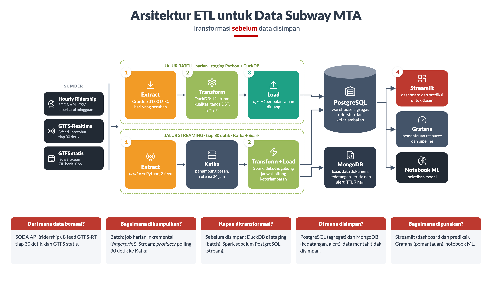

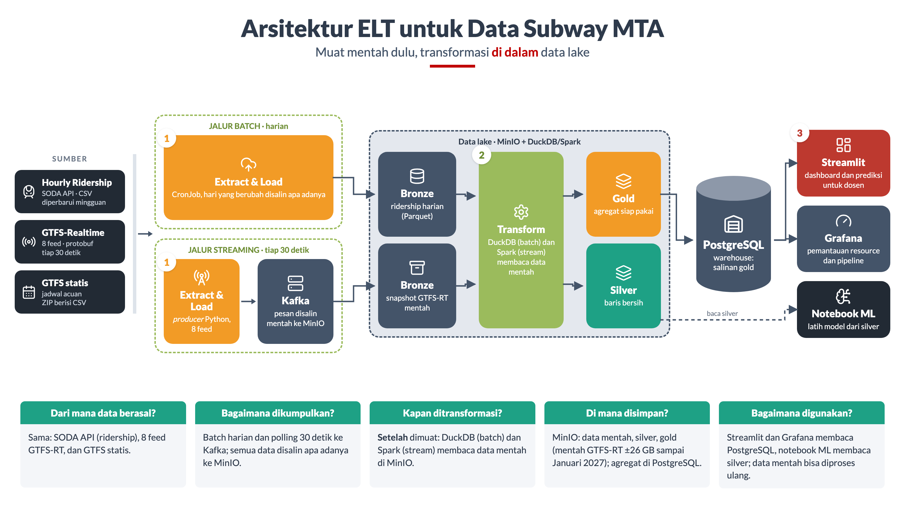

Kedua rancangan mencakup jalur *batch* dan *streaming*. Dari perbandingannya, dipilih jalur *batch* dari rancangan ELT dan jalur *streaming* dari rancangan ETL.

- **ELT untuk *ridership*.** MTA merevisi jutaan baris setiap minggu dan penandaan jam DST belum konsisten antartahun sehingga data mentah di *bronze* memungkinkan pemrosesan ulang tanpa mengunduh ulang 46 juta baris. *Notebook* ML juga membutuhkan baris bersih di *silver*, bukan hanya agregat. *Dataset* tidak memuat data pribadi dan seluruh riwayat bersih hanya 127,8 MB dalam Parquet.
- **ETL untuk GTFS-RT.** Kedelapan *feed subway* bersama menghasilkan sekitar 1,7 GB data mentah per hari bila diambil setiap 30 detik, padahal *dashboard* hanya membutuhkan keterlambatan per menit. Spark Structured Streaming mentransformasikan data dari Kafka sebelum disimpan di PostgreSQL dan MongoDB; *snapshot* mentah hanya disimpan 2 hari karena arsip lengkapnya tersedia di subwaydata.nyc dan diperbarui setiap pagi.

Kedua rancangan memakai alat yang sama: DuckDB (*batch*) dan Spark (*stream*) hanya sebagai mesin transformasi dan PostgreSQL sebagai satu-satunya *warehouse*. ELT menyimpan data mentah di MinIO karena Parquet terkompresi jauh lebih hemat ruang daripada PostgreSQL, yang memakai penyimpanan bersama klaster. Teknologi yang dipakai beserta perannya adalah sebagai berikut.

| Teknologi | Peran | Dipakai pada |
|---|---|---|
| Python | *Extract* dari SODA API dan *producer* GTFS-RT | ETL, ELT, dan *streaming* |
| DuckDB | Mesin transformasi data *batch* (SQL di dalam *job* Python) | ETL dan ELT |
| MinIO | *Data lake*: *bronze*, *silver*, *gold*, dan *snapshot* mentah GTFS-RT | ELT dan *streaming* |
| PostgreSQL | Satu-satunya *warehouse*; sumber data Streamlit dan Grafana | Semua jalur |
| Apache Kafka | Penampung pesan GTFS-RT selama 24 jam | *Streaming* |
| Spark Structured Streaming | Transformasi *stream* GTFS-RT | *Streaming* |
| MongoDB | Kedatangan kereta dan *alert* layanan (TTL 7 hari) | *Streaming* |
| Streamlit dan Plotly | *Dashboard* dan prediksi ML untuk dosen dan tim | Penyajian |
| Grafana dan Prometheus | Pemantauan *resource* klaster dan status *pipeline* | Operasi |
| Kubernetes (k3s) | Menjalankan CronJob, Deployment, dan StatefulSet | Semua jalur |
| Cloudflare Tunnel dan Access | Akses dosen ke Streamlit dengan login email | Penyajian |

*Pipeline* dirancang untuk berjalan terus sampai 31 Januari 2027 (sekitar 11 minggu). Dengan retensi *snapshot* GTFS-RT 2 hari, data MongoDB 7 hari, dan keterlambatan per menit 14 hari, perkiraan penyimpanan pada akhir periode adalah sekitar 2,1 GB, dengan CPU sekitar 2,4 vCPU dan RAM sekitar 5 GiB. Hasilnya disajikan lewat aplikasi Streamlit yang dibuka untuk dosen dan tim melalui Cloudflare Tunnel dengan login email (Cloudflare Access). Perhitungan, pemulihan otomatis, pemantauan, dan langkah akhir periode ada pada subbab 2.10 dan 2.11 laporan.
