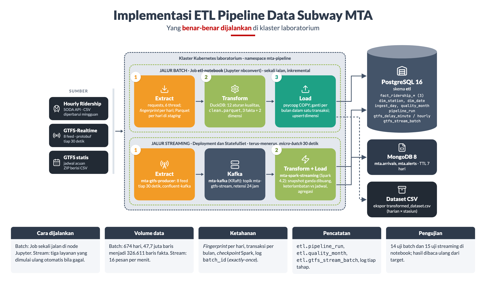
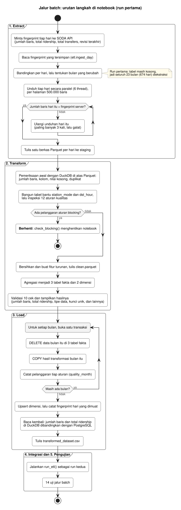
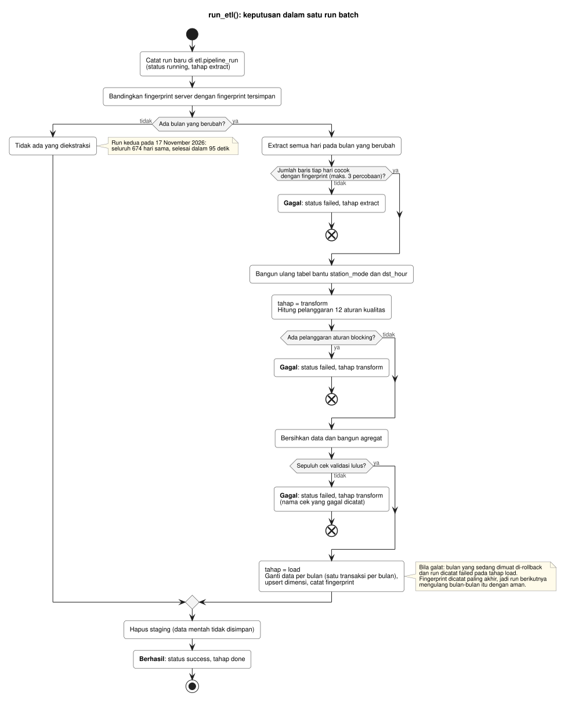
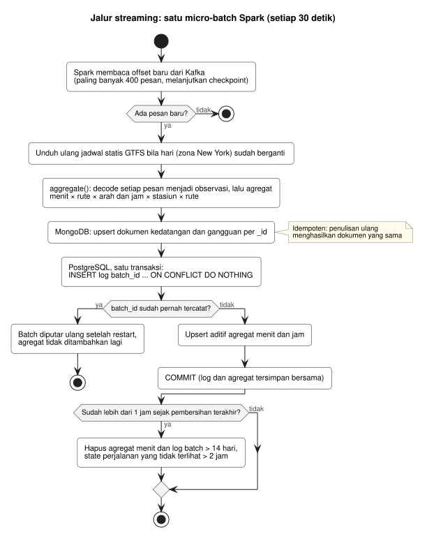
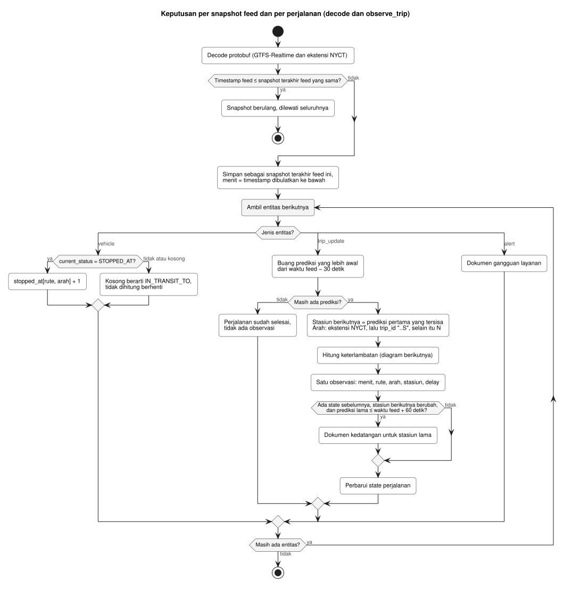
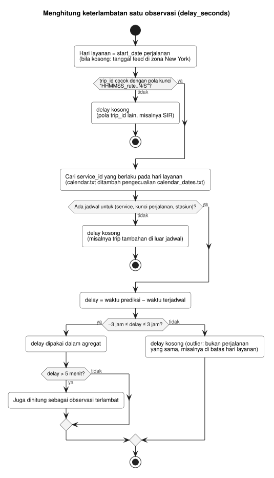

# Pegangan Alur Pipeline ETL Minggu 10

**Kelompok Smile (TK47G06) · Mata kuliah Big Data**

Pegangan internal untuk memahami dan menjelaskan pipeline Minggu 10: urutan langkahnya, alasan di balik tiap
langkah, dan keputusan yang diambil kode pada setiap percabangan. Angka contoh berasal dari run penuh di klaster pada
17 November 2026 (sama dengan laporan Minggu 10). Nama fungsi merujuk ke `ETL_Pipeline.py` (sumber *notebook*),
`streaming/producer.py`, dan `streaming/spark_etl.py`.

## 1. Gambaran singkat

| Jalur | Sumber | Extract | Transform | Load |
|---|---|---|---|---|
| Batch | MTA Subway Hourly Ridership (data.ny.gov, `5wq4-mkjj`) | SODA API → Parquet per hari di *staging* | DuckDB: 12 aturan kualitas, pembersihan, fitur, agregasi | PostgreSQL skema `etl`, diganti per bulan |
| Streaming | 8 feed GTFS-Realtime MTA | `producer.py` → Kafka setiap 30 detik | `spark_etl.py` di Spark Structured Streaming: keterlambatan terhadap jadwal statis | PostgreSQL `etl.gtfs_*`, MongoDB `mta.arrivals` dan `mta.alerts` |

Dalam satu kalimat:

* **Batch**: setiap run menanyakan ke server hari mana yang berubah, mengunduh ulang bulan yang memuat hari itu,
  membersihkan dan mengagregasinya di DuckDB, lalu mengganti bulan tersebut di PostgreSQL.
* **Streaming**: setiap 30 detik *producer* mengirim delapan *snapshot* feed ke Kafka; Spark mengubahnya menjadi
  keterlambatan per menit dan per jam di PostgreSQL, serta kedatangan kereta dan gangguan layanan di MongoDB.

**Kaitan dengan Minggu 9 dan 11.** Minggu 9 mengumpulkan diagram rancangan pipeline ETL dan ELT. Minggu 10 meminta
implementasi ETL, sehingga rancangan ETL diterapkan pada kedua sumber. Tabel batch disimpan di skema `etl` agar terpisah
dari pipeline ELT Minggu 11.

## 2. Alur pemikiran: dari sifat data ke rancangan

Setiap keputusan berawal dari satu fakta tentang data atau lingkungannya. Baca tiap baris dari kiri ke kanan:
fakta → akibatnya → keputusan.

### 2.1 Jalur batch

| # | Fakta | Akibatnya | Keputusan |
|---|---|---|---|
| 1 | MTA memperbarui dataset setiap minggu dan sekaligus merevisi baris beberapa bulan terakhir. | Mengambil "data baru" saja tidak cukup; hari lama bisa berubah atau hilang. | Sebelum mengunduh, server ditanya *fingerprint* tiap hari: jumlah baris, total `ridership`, total `transfers`, dan `max(:updated_at)` (`server_fingerprints`). |
| 2 | Pola ETL tidak menyimpan data mentah di target. | Angka satu bulan tidak bisa ditambal per hari; harus dihitung ulang dari semua hari di bulan itu. | Unit pembaruan adalah **bulan**: bila satu hari berubah, semua hari di bulan itu diekstraksi (`plan_months`). |
| 3 | Data berjumlah 47.760.351 baris, sedangkan RAM di klaster bersama terbatas. | Memuat semuanya ke pandas berisiko kehabisan memori. | Setiap hari disimpan sebagai Parquet di *staging* (397 MB, zstd), lalu DuckDB membaca langsung dari berkas dengan batas memori 2 GB. |
| 4 | SODA API membatasi ukuran halaman dan kadang menolak permintaan (HTTP 429/5xx). | Unduhan bisa gagal atau terpotong tanpa disadari. | Halaman 500.000 baris diurutkan `:id`, *retry* dengan jeda eksponensial, dan jumlah baris tiap hari dicocokkan dengan fingerprint (diulang sampai tiga kali). Enam unduhan paralel: 674 hari dalam 14–38 menit, tergantung kecepatan server SODA saat itu. |
| 5 | Ada masalah kualitas; sebagian punya perbaikan yang aman, sebagian tidak. | Pipeline perlu tahu kapan memperbaiki dan kapan berhenti. | 12 aturan kualitas, masing-masing ditandai *blocking* atau tidak (Bagian 4). |
| 6 | Analisis membutuhkan pola per jam, per stasiun, dan per kategori tarif. | Gudang data cukup berisi agregat dan dimensi, bukan 47 juta baris bersih. | 3 tabel fakta (jam × metode bayar, hari × stasiun, hari × kategori tarif) dan 2 dimensi (stasiun, tanggal). |
| 7 | Revisi MTA harus menggantikan nilai lama, dan pipeline harus boleh dijalankan ulang. | Load harus idempoten. | Per bulan: `DELETE` lalu `COPY` dalam satu transaksi; dimensi di-*upsert*; fingerprint dicatat paling akhir. |
| 8 | Data mentah tidak boleh menetap (pola ETL). | *Staging* hanya titipan sementara. | *Staging* dihapus setelah Load berhasil. |
| 9 | Run bisa gagal di tahap mana pun. | Perlu jejak untuk mengetahui di mana gagalnya. | Setiap run dicatat di `etl.pipeline_run` beserta status dan tahapnya. |

### 2.2 Jalur streaming

| # | Fakta | Akibatnya | Keputusan |
|---|---|---|---|
| 1 | Feed GTFS-RT diperbarui MTA sekitar setiap 30 detik, berformat protobuf, dan terbagi menjadi 8 feed. | Data harus diambil terus-menerus. | *Producer* Python mengambil 8 feed secara paralel setiap 30 detik; satu feed menjadi satu pesan Kafka dengan *key* nama feed. |
| 2 | *Producer* dan pemroses bisa mati atau dimulai ulang secara terpisah. | Tanpa penyangga, pesan selama pemroses mati akan hilang. | Kafka menjadi penyangga (retensi 24 jam); Spark melanjutkan dari *checkpoint* offset. |
| 3 | Data mentah kedelapan feed sekitar 1,7 GB per hari, padahal yang dibutuhkan hanya keterlambatan per menit. | Menyimpan data mentah memboroskan penyimpanan bersama (±26 GB sampai akhir Januari 2027). | ETL: data ditransformasi dulu di Spark; pesan mentah hanya ditahan Kafka selama 24 jam. |
| 4 | Feed tidak memiliki kolom keterlambatan. | Keterlambatan harus dihitung sendiri. | Prediksi kedatangan dibandingkan dengan jadwal statis GTFS (`delay_seconds`). |
| 5 | Satu `trip_update` memuat prediksi untuk banyak stasiun di depan, dan feed kadang belum diperbarui saat diambil. | Satu kereta bisa terhitung berkali-kali. | Satu observasi per kereta per *snapshot* (stasiun berikutnya saja), dan *snapshot* yang tidak lebih baru dilewati. |
| 6 | Satu menit bisa tersebar di dua *micro-batch*. | Agregat menit harus dijumlahkan, bukan ditimpa. | *Upsert* aditif ke PostgreSQL. |
| 7 | Setelah *restart*, Spark memutar ulang *batch* yang belum selesai di-*commit*. | *Upsert* aditif bisa menjumlahkan *batch* yang sama dua kali. | `batch_id` dicatat di `etl.gtfs_stream_batch` dalam transaksi yang sama; *batch* yang sudah tercatat dilewati (*exactly-once*). |
| 8 | Kedatangan dan gangguan berbentuk dokumen dengan atribut bervariasi dan hanya dibutuhkan sementara. | Kurang cocok dijadikan tabel agregat. | MongoDB dengan TTL 7 hari, *upsert* per `_id`. |
| 9 | Hasil Spark perlu dibuktikan benar. | Notebook tidak boleh menulis ulang logikanya sendiri. | Notebook mengimpor `spark_etl.py` dan membandingkan hasilnya dengan isi PostgreSQL dan MongoDB (Bagian 6). |

## 3. Alur jalur batch

### 3.1 Urutan langkah di notebook

Run pertama dijalankan sel demi sel supaya hasil tiap tahap terlihat. Tabel berikut merangkum tiap langkah, dan
diagram sesudahnya menunjukkan urutan sel beserta percabangannya.

| Langkah | Fungsi | Masukan → keluaran | Hasil run 17 November 2026 |
|---|---|---|---|
| Fingerprint server | `server_fingerprints()` | SODA API → satu baris per hari | 674 hari (1 Januari 2025 s.d. 5 November 2026), 47.760.351 baris |
| Rencana ekstraksi | `stored_fingerprints()`, `plan_months()` | fingerprint server dan `etl.ingest_day` → daftar bulan | 23 bulan (tabel masih kosong) |
| Extract | `extract()`, `extract_day()`, `download_day()` | CSV per halaman → Parquet per hari | 47.760.351 baris, 397 MB, 38,3 menit |
| Pemeriksaan awal | `create_raw_view()`, `count_duplicates()` | view `raw` → baris, kolom, nilai kosong, duplikat | 12 kolom, 0 nilai kosong, 0 duplikat |
| Inspeksi | `build_helper_tables()`, `RULES`, `count_violations()`, `check_blocking()` | `raw` → pelanggaran per aturan | 3 aturan non-*blocking* dilanggar (Bagian 4) |
| Transform | `transform()` (`CLEAN_SQL`, `AGGREGATES`) | `raw` → `clean.parquet` → tabel agregat | 47.760.351 baris bersih, 16 kolom |
| Validasi | `measure_clean()`, `validate()` | data bersih dan agregat → 10 cek lulus/gagal | 10 dari 10 lulus |
| Load | `load()`, `replace_month()`, `record_quality()`, `upsert_dimension()` | tabel DuckDB → PostgreSQL | 326.611 baris fakta dalam 21 detik |
| Baca kembali | `compare_fact()` | DuckDB dibandingkan dengan PostgreSQL | 3 dari 3 tabel fakta sama |
| Integrasi | `run_etl()` | run kedua | 0 hari diekstraksi (tidak ada perubahan) |
| Pengujian | tabel `tests` | 14 uji | 14 dari 14 berhasil |

### 3.2 Keputusan di dalam `run_etl()`

`run_etl()` menggabungkan seluruh tahap menjadi satu fungsi yang bisa dijadwalkan. Setiap tahap hanya berjalan bila
tahap sebelumnya berhasil, dan setiap kegagalan dicatat bersama tahapnya.

Empat gerbang yang menentukan jalannya run:

1. **Ada bulan yang berubah?** Bila tidak, run selesai tanpa menyentuh gudang data. Inilah yang terjadi pada run
   kedua: seluruh hari sama persis, sehingga tidak ada yang diekstraksi.
2. **Jumlah baris tiap hari cocok dengan fingerprint?** Bila tetap berbeda setelah tiga percobaan, run gagal di tahap
   extract sebelum ada data yang dimuat.
3. **Ada pelanggaran aturan *blocking*?** `check_blocking()` menghentikan run di tahap transform sebelum data
   dibersihkan, dengan pesan berisi nama aturan dan jumlah pelanggarannya.
4. **Sepuluh cek validasi lulus?** Termasuk jumlah baris bersih sama dengan baris hasil extract dan total `ridership`
   tidak berubah. Bila ada cek yang gagal, run berhenti sebelum Load dan nama cek itu dicatat di `pipeline_run`.

Tabel bantu `station_mode` dan `dst_hour` dibangun ulang dari data yang sedang diproses pada setiap run, sehingga
moda dominan dan jam peralihan DST selalu sesuai dengan rentang data run itu.

Bila Load gagal di tengah, bulan yang sudah di-*commit* tetap tersimpan, bulan yang sedang dimuat di-*rollback*, dan
fingerprint belum dicatat. Run berikutnya melihat hari-hari itu sebagai hari yang berubah lalu mengulangnya. Karena tiap
bulan diganti utuh (`DELETE` lalu `COPY`), pengulangan tidak menimbulkan duplikasi.

### 3.3 Aliran jumlah baris

| Tahap | Jumlah baris | Keterangan |
|---|---|---|
| Setelah Extract | 47.760.351 | Baris mentah di *staging*, sama dengan fingerprint server |
| Setelah Transform | 47.760.351 | Tidak ada baris yang dihapus |
| Setelah agregasi | 326.611 | 32.348 (jam) + 286.986 (hari × stasiun) + 7.277 (hari × kategori tarif) |
| Di PostgreSQL | 326.611 | Sama dengan hasil agregasi |

Jumlah baris turun karena yang dimuat adalah agregat. Buktinya tidak ada data yang hilang: total `ridership`
2.437.504.300 sama persis di data mentah, data bersih, ketiga tabel fakta, dan fingerprint server (0 hari berbeda).

### 3.4 Tabel jalur batch di skema `etl`

| Tabel | Kunci | Isi | Baris |
|---|---|---|---|
| `fact_ridership_hourly` | jam, metode bayar | `ridership`, `transfers`, penanda jam DST | 32.348 |
| `fact_ridership_daily_station` | hari, stasiun | `ridership`, `transfers`, `ridership` OMNY | 286.986 |
| `fact_ridership_daily_fare_class` | hari, kategori tarif | `ridership` | 7.277 |
| `dim_station` | stasiun | nama, borough, moda, koordinat terbaru | 428 |
| `dim_date` | tanggal | tahun, bulan, hari, hari dalam minggu, akhir pekan | 674 |
| `ingest_day` | hari | fingerprint yang terakhir dimuat | 674 |
| `quality_month` | bulan, aturan | jumlah pelanggaran | 276 (23 bulan × 12 aturan) |
| `pipeline_run` | `run_id` | status, tahap, jumlah hari dan baris, bulan, pesan galat | satu baris per run |

## 4. Aturan kualitas: kapan diperbaiki, kapan berhenti

Sebuah aturan dibuat *blocking* bila tidak ada perbaikan yang bisa dipertanggungjawabkan. Misalnya, kategori yang salah
tidak bisa ditebak nilai benarnya, sehingga pipeline lebih baik berhenti daripada memuat data yang keliru. Aturan
non-*blocking* punya perbaikan yang jelas, dan jumlah perubahannya dicatat.

| Aturan | Melanggar bila | *Blocking* | Ditemukan | Penanganan |
|---|---|---|---|---|
| `missing_value` | ada kolom yang kosong | ya | 0 | — |
| `invalid_category` | moda, metode bayar, atau borough di luar daftar | ya | 0 | — |
| `nonpositive_ridership` | `ridership ≤ 0` | ya | 0 | — |
| `negative_transfers` | `transfers < 0` | tidak | 294 | diubah menjadi 0 |
| `transfers_exceed_ridership` | `transfers > ridership` | ya | 0 | — |
| `non_integer_count` | hitungan berupa pecahan | ya | 0 | tipe diubah ke INTEGER |
| `outside_nyc` | koordinat di luar kotak NYC | ya | 0 | — |
| `not_on_hour` | timestamp tidak tepat di awal jam | ya | 0 | — |
| `fare_class_payment_mismatch` | kategori tarif bertentangan dengan metode bayar | ya | 0 | — |
| `station_mode_mismatch` | moda baris berbeda dengan moda dominan stasiunnya | tidak | 3 | diganti moda dominan |
| `georeference_mismatch` | `georeference` berbeda dengan `latitude`/`longitude` | ya | 0 | kolom dibuang setelah divalidasi |
| `dst_transition_hour` | baris pada jam peralihan DST | tidak | 5.270 | tidak dihapus, ditandai `is_dst_transition` |

Akibat perbaikan yang perlu bisa dijelaskan:

* Total `transfers` naik dari 122.445.290 menjadi 122.445.657 (+367) karena 294 nilai negatif, yang jumlahnya −367,
  diubah menjadi 0.
* Total `ridership` tidak berubah karena tidak ada baris yang dihapus.
* Kolom bertambah dari 12 menjadi 16: `georeference` dibuang dan lima fitur ditambahkan (`date`, `hour_of_day`,
  `day_of_week`, `is_weekend`, `is_dst_transition`).

Sepuluh cek validasi setelah transformasi: jumlah baris bersih sama dengan baris mentah; tidak ada nilai kosong;
`ridership` dan `transfers` bertipe INTEGER; tidak ada `transfers` negatif; satu moda per stasiun; total `ridership`
tidak berubah; total agregat jam sama dengan data bersih; total agregat harian stasiun sama dengan data bersih; kunci
agregat unik; tidak ada duplikat kunci. Pada run bertahap hasilnya ditampilkan di sel 2d; di dalam `run_etl()`, satu cek
yang gagal saja sudah menghentikan run sebelum Load.

## 5. Alur jalur streaming

| Tahap | Fungsi |
|---|---|
| Extract | `producer.ensure_topic()`, `producer.fetch()`, `producer.main()` |
| Transform | `spark_etl.decode()`, `observe_trip()`, `delay_seconds()`, `Schedule`, `MinuteDelay`, `HourDelay`, `aggregate()` |
| Load | `spark_etl.write()`, `prune_old_data()`, `main()` |

### 5.1 *Producer* (Extract)

`producer.main()` berjalan terus sebagai Deployment `mta-gtfs-producer`:

1. Saat mulai, `ensure_topic()` membuat topik `mta-gtfs-stream` bila belum ada (satu partisi, retensi 24 jam).
2. Pada setiap putaran, kedelapan feed diambil paralel dengan `fetch()`. Feed yang gagal diambil dilewati pada putaran
   itu saja, tanpa menghentikan *producer*.
3. Setiap feed dikirim apa adanya sebagai satu pesan: *key* nama feed, *value* bytes protobuf, *header* `fetched_at`,
   kompresi zstd, `acks=all`.
4. *Producer* tidur selama sisa waktu agar satu putaran tetap 30 detik.

*Producer* sengaja tidak men-*decode* apa pun. Tugasnya hanya Extract, sehingga seluruh logika transformasi berada di
satu tempat, yaitu `spark_etl.py`.

### 5.2 Satu *micro-batch* Spark

Spark (Deployment `mta-spark-streaming`, mode `local[2]`) memanggil `write()` setiap 30 detik melalui `foreachBatch`.

Urutan penulisan sengaja dibuat seperti ini:

* **MongoDB lebih dahulu**, karena *upsert* per `_id` aman diulang. Bila Spark memutar ulang *batch*, dokumen yang sama
  hanya ditulis ulang.
* **Log *batch* dan agregat dalam satu transaksi PostgreSQL.** Bila `batch_id` sudah ada, `INSERT … ON CONFLICT DO
  NOTHING` tidak mengembalikan baris dan agregat tidak ditambahkan lagi. Bila transaksi gagal, log dan agregat sama-sama
  batal, sehingga *batch* itu diproses ulang secara utuh.

### 5.3 Keputusan per *snapshot* dan per perjalanan

`aggregate()` memanggil `decode()` untuk setiap pesan. Diagram berikut menunjukkan percabangan di dalam `decode()` dan
`observe_trip()`.

*State* yang dibawa dari satu *micro-batch* ke *micro-batch* berikutnya:

* `last_snapshot`: timestamp *snapshot* terbaru per feed, untuk mendeteksi *snapshot* berulang;
* `trip_state`: stasiun berikutnya dan prediksinya untuk setiap perjalanan, untuk mendeteksi kedatangan (kereta yang
  sudah melewati stasiun).

*State* ini hanya ada di memori Spark dan kembali kosong setelah *restart*. Karena itu notebook perlu menyiapkan
*state* lebih dahulu sebelum membandingkan hasil (Bagian 6.2).

### 5.4 Menghitung keterlambatan

Jadwal statis diunduh dari `gtfs_subway.zip` sekali sehari (`Schedule.refresh()`). Perjalanan *realtime* dicocokkan
dengan jadwal melalui kunci `HHMMSS_rute..arah` (`TRIP_KEY`) karena akhiran pola rute pada `trip_id` *realtime* dan
statis bisa berbeda.

Pada jendela pemeriksaan run 17 November, 76% observasi mendapatkan nilai keterlambatan (42% pada run 15 November). Observasi tanpa nilai keterlambatan tetap
dihitung di kolom `observations`, tetapi tidak masuk `delay_observations` maupun rata-rata keterlambatan.

### 5.5 Target dan masa simpan

| Tempat | Isi | Kunci | Masa simpan |
|---|---|---|---|
| Kafka `mta-gtfs-stream` | *Snapshot* feed mentah | offset | 24 jam |
| `etl.gtfs_delay_minute` | Observasi, keterlambatan, dan kereta berhenti per menit × rute × arah | menit, rute, arah | 14 hari |
| `etl.gtfs_delay_hourly` | Keterlambatan per jam × stasiun × rute | jam, stasiun, rute | tidak dihapus |
| `etl.gtfs_stream_batch` | Log *micro-batch* (offset, jumlah baris, durasi) | `batch_id` | 14 hari |
| MongoDB `mta.arrivals` | Kedatangan kereta di stasiun | `start_date`, `trip_id`, dan stasiun | TTL 7 hari |
| MongoDB `mta.alerts` | Gangguan layanan | id entitas *alert* | TTL 7 hari |
| Memori Spark (`trip_state`) | Posisi tiap perjalanan | `trip_id` | 2 jam sejak terakhir terlihat |

## 6. Cara notebook membuktikan hasilnya

### 6.1 Jalur batch

Buktinya berupa angka yang harus sama di beberapa tempat:

* jumlah baris hasil extract sama dengan fingerprint server (47.760.351);
* jumlah baris bersih sama dengan jumlah baris mentah;
* total `ridership` sama di data mentah, data bersih, ketiga tabel fakta, dan `ingest_day` (0 hari berbeda);
* jumlah baris dan total `ridership` tiap tabel fakta sama antara DuckDB dan PostgreSQL;
* run kedua tidak mengubah apa pun (idempoten).

### 6.2 Jalur streaming: jendela pembanding

Notebook tidak menjalankan Spark. Notebook membaca pesan yang sudah diproses Spark dari Kafka, menjalankan fungsi yang
sama (`spark_etl.aggregate`), lalu membandingkan hasilnya dengan data yang sudah dimuat Spark.

| Bagian offset | Jumlah pesan | Kegunaan |
|---|---|---|
| *Prime* | 240 (±15 menit) | Diproses lebih dahulu agar `last_snapshot` dan `trip_state` notebook sama dengan milik Spark |
| Jendela | 320 (±20 menit, 8 feed × 2 putaran per menit) | Dibandingkan dengan PostgreSQL dan MongoDB |
| Batas akhir | offset terakhir di `etl.gtfs_stream_batch` | Pesan setelahnya belum diproses Spark, jadi tidak dipakai |

Langkahnya:

1. Baca log `etl.gtfs_stream_batch` untuk mengetahui offset terakhir yang sudah dimuat Spark.
2. Baca 560 pesan sebelum offset itu dengan konsumen Kafka bergrup sementara tanpa *commit*, sehingga Spark tidak
   terganggu.
3. Kosongkan *state*, lalu proses 240 pesan *prime*.
4. Proses 320 pesan jendela dengan `aggregate()` yang sama persis.
5. Bandingkan agregat menit dengan `etl.gtfs_delay_minute`. Dua menit pertama dan dua menit terakhir tidak dipakai karena
   bisa berisi pesan di luar jendela.
6. Cari dokumen kedatangan hasil notebook di MongoDB.

Hasil 17 November 2026: 17 menit lengkap dan 903 kunci (menit × rute × arah) dibandingkan, **0 kunci berbeda**;
3.742 dari 3.742 kedatangan ditemukan di MongoDB.

Karena *state* Spark kosong setelah *restart*, ke-560 pesan itu harus seluruhnya diproses setelah *restart* terakhir.
Jadi, bila Spark baru dimulai ulang, Bagian B notebook baru boleh dijalankan sekitar 35 menit kemudian.

### 6.3 Ringkasan pengujian

| Jalur | Uji | Hasil penting |
|---|---|---|
| Batch | 14 berhasil | jumlah baris = server, 0 nilai kosong dan duplikat, total `ridership` tetap, 3/3 tabel konsisten, 0 hari berbeda dengan server |
| Streaming | 15 berhasil | 8 feed, 0 kunci berbeda dengan Spark, 5.677 *batch* tanpa celah offset, latensi median 6 detik, *lag* 8 pesan (satu putaran *producer*) |

## 7. Keputusan desain dan alternatifnya

| Keputusan | Alternatif yang tidak dipilih | Alasan |
|---|---|---|
| Ekstraksi inkremental dengan fingerprint harian | Mengunduh ulang semua data setiap run; atau hanya memakai `:updated_at` | Unduhan penuh memakan 14–38 menit dan membebani API; fingerprint juga menangkap hari yang barisnya dihapus atau totalnya berubah |
| Mengganti satu bulan penuh | Mengganti per hari | Tanpa data mentah, angka satu bulan (termasuk catatan kualitas `quality_month`) hanya bisa dihitung ulang dari semua harinya |
| DuckDB di atas Parquet *staging* | pandas di memori; Spark untuk batch | 47,7 juta baris tidak nyaman di memori; DuckDB berjalan dalam satu proses tanpa klaster dan sudah dipakai sejak bagian III notebook proyek |
| Memuat agregat dan dimensi | Memuat 47 juta baris bersih ke PostgreSQL | Kebutuhan analisis cukup dengan agregat; baris bersih per jam disediakan jalur ELT Minggu 11 |
| `DELETE` lalu `COPY` per bulan dalam satu transaksi | `INSERT … ON CONFLICT` per baris untuk tabel fakta | Baris yang hilang dari server ikut terhapus; `COPY` jauh lebih cepat (326.611 baris dalam 21 detik) |
| Aturan *blocking* dan perbaikan otomatis | Membuang semua baris bermasalah | Membuang baris mengubah total penumpang; perbaikan yang jelas diterapkan dan dicatat, sisanya menghentikan pipeline |
| Jam DST ditandai | Menghapus jam DST | Datanya asli; menghapusnya menghilangkan penumpang |
| Kafka sebagai penyangga | *Producer* langsung menulis ke Spark atau basis data | *Producer* dan Spark bisa *restart* terpisah tanpa kehilangan pesan; pesan bisa dibaca ulang oleh notebook |
| Spark Structured Streaming dengan `foreachBatch` | Konsumen Kafka Python biasa | *Checkpoint* offset dan pemutaran ulang otomatis; `foreachBatch` memungkinkan logika Python dan penulisan ke dua target |
| Satu observasi per kereta per *snapshot* | Semua prediksi stasiun dijadikan observasi | Kereta yang sama tidak terhitung berkali-kali; prediksi stasiun terdekat paling andal |
| *Upsert* aditif dengan log `batch_id` dalam satu transaksi | Menimpa agregat; atau tanpa log | Satu menit tersebar di dua *batch*; tanpa log, *batch* yang diputar ulang terhitung dua kali |
| MongoDB untuk kedatangan dan gangguan | Tabel PostgreSQL | Dokumen dengan atribut bervariasi; TTL bawaan untuk data sementara |
| Notebook mengimpor `spark_etl.py` | Menulis ulang logika di notebook | Perbandingan membuktikan kode yang benar-benar dijalankan Spark |

## 8. Pertanyaan yang mungkin muncul

**Kenapa run kedua tidak mengekstraksi apa pun?**
Fingerprint seluruh 674 hari di server sama dengan yang tersimpan setelah run pertama. Ini sekaligus bukti bahwa
pipeline inkremental dan aman dijalankan ulang.

**Kenapa jumlah baris di PostgreSQL (326.611) jauh lebih kecil dari 47,7 juta?**
Yang dimuat adalah agregat, bukan baris mentah. Totalnya tetap sama: 2.437.504.300 penumpang.

**Kenapa total `transfers` berubah, tetapi `ridership` tidak?**
294 nilai `transfers` negatif (jumlahnya −367) diubah menjadi 0, sehingga total `transfers` naik 367. Tidak ada baris
yang dihapus, sehingga `ridership` tetap.

**Kenapa satu bulan diekstraksi ulang padahal yang berubah hanya beberapa hari?**
Data mentah tidak disimpan, jadi angka satu bulan hanya bisa dihitung ulang dari semua hari di bulan itu.

**Apa yang terjadi bila data baru melanggar aturan *blocking*?**
Run berhenti di tahap transform sebelum Load, dicatat `failed` di `pipeline_run` beserta nama aturan yang dilanggar, dan
gudang data tidak berubah. Contohnya, kategori `borough` baru yang tidak dikenal akan menghentikan pipeline alih-alih
membuat grup baru di tabel fakta.

**Apa yang terjadi bila jumlah baris dari server berbeda dengan fingerprint?**
Hari itu diunduh ulang, paling banyak tiga kali. Bila tetap berbeda, run gagal di tahap extract dan tidak ada data yang
dimuat.

**Bagaimana bila Load gagal di tengah?**
Bulan yang sedang dimuat di-*rollback*. Fingerprint dicatat paling akhir, jadi run berikutnya mengulang bulan-bulan itu,
dan penggantian per bulan mencegah duplikasi.

**Bagaimana bila Spark mati?**
Kubernetes memulainya ulang dan Spark melanjutkan dari *checkpoint*. Pesan selama Spark mati tetap ada di Kafka (24 jam).
*Batch* yang diputar ulang dilewati berkat log `batch_id`, dan MongoDB hanya menulis ulang dokumen yang sama. Pada run
17 November: 5.677 *batch*, `batch_id` unik, offset berurutan tanpa celah.

**Apakah jalur streaming pernah terputus?**
Pernah sekali. Pada 17 November sekitar pukul 15.30 WIB, pod *producer* di-*evict* Kubernetes karena disk node penuh.
Deployment langsung membuat pod baru, sehingga data hanya bolong sekitar 7 menit, dan Spark tetap berjalan. Setelah itu
*producer* diberi *request* `ephemeral-storage` 64 Mi (instalasi paketnya menulis ±30 MB ke disk) supaya tidak dipilih
lebih dahulu bila node kembali kekurangan disk.

**Kenapa tidak semua observasi punya nilai keterlambatan?**
Porsinya berubah menurut waktu pengambilan: 42% pada run 15 November dan 76% pada run 17 November.
Keterlambatan hanya bisa dihitung bila perjalanan ditemukan di jadwal statis. Perjalanan dengan pola `trip_id` lain
(misalnya SIR), trip tambahan, atau selisih lebih dari 3 jam dibiarkan tanpa nilai, tetapi tetap dihitung sebagai
observasi.

**Kenapa memakai dua basis data?**
PostgreSQL menyimpan agregat berstruktur tetap yang dianalisis dengan SQL. MongoDB menyimpan dokumen kedatangan dan
gangguan yang atributnya bervariasi dan hanya dibutuhkan 7 hari (TTL).

**Kenapa data mentah tidak disimpan?**
Itulah pola ETL: data ditransformasi sebelum disimpan. Pada jalur batch, *staging* dihapus setelah Load. Pada jalur
streaming, pesan hanya ditahan Kafka 24 jam, karena data mentahnya sekitar 1,7 GB per hari.

**Seberapa cepat jalur streaming?**
Median latensi dari waktu feed sampai tersimpan di PostgreSQL 6 detik, rata-rata durasi satu *micro-batch* 0,61 detik,
dan *lag* Kafka 8 pesan, yaitu satu putaran *producer* yang menunggu *micro-batch* berikutnya.

**Apa fungsi `ETL_DAY_LIMIT`?**
Untuk uji cepat: hanya N hari terakhir yang diproses, dan di dalam `run_etl()` hanya hari yang pernah dimuat yang
dibandingkan. Run penuh tidak memakainya.
